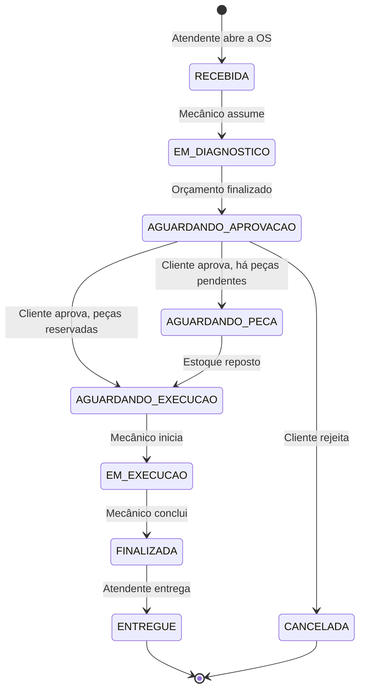

# SIAES - Sistema Integrado de Atendimento e Execução de Serviços

MVP de gestão de uma oficina mecânica, desenvolvido para o Tech Challenge da Fase 1 da pós-graduação SOAT (Software Architecture) da FIAP.

## Objetivo

Organizar o atendimento da oficina do primeiro contato com o cliente até a entrega do veículo. O sistema controla as ordens de serviço (OS), o orçamento, o estoque de peças e o acompanhamento pelo cliente, com regras de negócio explícitas, rastreabilidade de cada mudança de status e segurança no acesso às informações.

## Solução

A aplicação é uma API REST com duas frentes:

| Frente | Quem usa | Acesso | O que oferece |
| :--- | :--- | :--- | :--- |
| **Frente da Loja** | Atendente, Mecânico e Gerente | Autenticado por JWT, com permissões por perfil (RBAC) | Cadastro de clientes, veículos, serviços, peças e usuários; abertura e acompanhamento das OS; diagnóstico, orçamento, execução e entrega; registro no balcão da aprovação ou rejeição dada pelo cliente; relatórios de tempo médio |
| **Frente do Cliente** | Cliente da oficina | Público, identificado pelo número da OS junto com o CPF/CNPJ, com limite de requisições | Consulta do status da OS com a estimativa de entrega; aprovação ou rejeição do orçamento |

O centro do sistema é a **máquina de estados da OS**. Cada transição é feita por um método do agregado `OrdemServico`, que bloqueia as transições inválidas e grava um registro no histórico de status:



O Gerente também pode cancelar a OS de `RECEBIDA` até `EM_EXECUCAO`, informando o motivo.

Junto com a OS, o sistema cuida de:

- **Orçamento:** soma dos serviços e das peças com os preços congelados no momento do orçamento, para que uma mudança no catálogo não altere uma OS já orçada.
- **Estoque:** reserva das peças na conclusão do orçamento; registro das peças pendentes quando falta saldo; prioridade para a OS mais antiga quando o estoque é reposto; baixa no início da execução e estorno na rejeição ou no cancelamento. O saldo disponível nunca fica negativo.
- **Métricas:** horários de abertura, início da execução e finalização, usados na estimativa de entrega e no relatório de tempo médio de execução.

Os requisitos completos estão em [`docs/requisitos-funcionais.md`](docs/requisitos-funcionais.md) (RF-01 a RF-27) e [`docs/requisitos-nao-funcionais.md`](docs/requisitos-nao-funcionais.md) (RNF-01 a RNF-16).

## Arquitetura

O sistema é um **monólito em camadas** (RNF-01) modelado com **Domain-Driven Design**. O domínio fica isolado em Python puro, sem framework web, ORM nem biblioteca de JWT (RNF-02).

```text
src/
├── domain/           Regras de negócio: entidades, agregados, objetos de valor, eventos e portas de repositório
├── application/      Casos de uso que orquestram o domínio, portas de serviços técnicos e Event Dispatcher
├── infrastructure/   Adaptadores: PostgreSQL (SQLAlchemy), JWT, bcrypt e configuração
└── presentation/     API FastAPI: rotas, DTOs, autenticação das rotas, tratamento de erros e interface web
```

- **Regra de dependência:** as dependências apontam sempre para dentro, em direção ao domínio. O domínio não conhece as outras camadas, e os casos de uso dependem de interfaces (portas), não das implementações.
- **Portas e adaptadores:** cada dependência externa (banco, token, hash de senha) é uma interface no domínio ou na aplicação, com a implementação em `infrastructure/`. Só o `presentation/container.py` conhece as implementações e as monta.
- **Agregados:** `OrdemServico`, com os itens, o orçamento e o histórico de status, e `EstoquePeca`, com as quantidades física e reservada de cada peça.
- **Eventos de domínio:** quando a regra de um agregado precisa alterar o outro (por exemplo, a baixa do estoque ao iniciar a execução), o agregado emite um evento, e o Event Dispatcher síncrono chama o handler dentro da mesma transação.
- **Transações:** cada operação crítica roda em uma única unidade de trabalho, com rollback completo em caso de falha (RNF-08).

A arquitetura está documentada nos quatro níveis do [modelo C4](docs/ddd/c4-model.md) (contexto, contêineres, componentes e diagrama de classes). As regras de onde colocar cada parte do código estão no [guia de desenvolvimento](docs/guia-de-desenvolvimento.md).

## Tecnologias

| Área | Tecnologia |
| :--- | :--- |
| Linguagem | Python 3.12 |
| API | FastAPI e Uvicorn, com documentação OpenAPI (Swagger) em `/docs` |
| Banco de dados | PostgreSQL 16 |
| Acesso ao banco | SQLAlchemy 2.0 no modo assíncrono, com o driver asyncpg |
| Migrations | Alembic, aplicado na subida do contêiner |
| Configuração | pydantic-settings, com as variáveis lidas do ambiente (`.env`) |
| Autenticação | JWT com PyJWT e senhas com hash bcrypt |
| Rate limiting | SlowAPI, nas rotas públicas |
| Dependências | uv, com `pyproject.toml` e lockfile `uv.lock` |
| Testes | pytest, pytest-asyncio, pytest-cov e httpx |
| Lint e formatação | Ruff |
| Análise de vulnerabilidades | pip-audit (dependências), Bandit (código) e Trivy (imagem Docker) |
| Teste de desempenho | Locust |
| Execução | Docker (imagem multi-stage) e Docker Compose, com os serviços `app` e `db` |

## Banco de dados

O banco escolhido é o **PostgreSQL 16** (RNF-09), pelos seguintes motivos:

1. **Estrutura relacional forte.** Os dados formam vínculos rígidos: um cliente tem veículos, cada OS pertence a um cliente e a um veículo, e cada OS tem itens de serviço e de peça. O modelo relacional representa essas relações de forma natural.
2. **Integridade referencial.** Chaves estrangeiras e restrições de unicidade (como o documento do cliente e o e-mail do usuário) impedem que uma exclusão ou um dado duplicado corrompa o histórico de atendimentos e o estoque. A exclusão de clientes, veículos, serviços e peças é lógica, para preservar as OS antigas.
3. **Consistência atômica.** A reserva, a baixa e o estorno de peças alteram ao mesmo tempo a OS e o estoque. As transações ACID garantem que essas alterações aconteçam juntas ou não aconteçam (RNF-08), e o controle de concorrência impede que duas OS reservem o mesmo saldo.

O schema é versionado com o Alembic, em `migrations/`, e aplicado automaticamente antes da subida da API.

## Pré-requisitos

| Para | Ferramenta |
| :--- | :--- |
| Executar a aplicação | [Docker](https://docs.docker.com/get-docker/) com o Docker Compose v2 (`docker compose`) |
| Rodar os testes e desenvolver | Os itens acima e o [uv](https://docs.astral.sh/uv/) **0.8.22**, a versão exigida pelo `pyproject.toml`. O uv instala o Python 3.12 sozinho, se ele não estiver na máquina |

Com outra versão do uv instalada, troque para a 0.8.22 com `uv self update 0.8.22` ou use `uvx uv@0.8.22` no lugar de `uv` nos comandos abaixo.

As portas `8000` (API) e, para os testes de integração, `5432` (PostgreSQL) precisam estar livres.

## Como executar

**1. Crie o `.env` a partir do exemplo:**

```bash
cp .env.example .env
```

**2. Preencha as variáveis obrigatórias** no `.env`. A aplicação não inicia se alguma delas estiver vazia (RNF-06):

| Variável | O que informar |
| :--- | :--- |
| `POSTGRES_USER` e `POSTGRES_PASSWORD` | Usuário e senha do banco, criados pelo container `db` na primeira subida |
| `JWT_SECRET_KEY` | Chave de assinatura dos tokens; use um texto aleatório e longo |
| `ADMIN_PASSWORD` | Senha do Gerente padrão, `admin@oficina.com` |
| `SEED_DEMO`, `DEMO_ATENDENTE_PASSWORD` e `DEMO_MECANICO_PASSWORD` | Opcionais: com `SEED_DEMO=true`, as duas senhas passam a ser obrigatórias (veja [Usuários de demonstração](#usuários-de-demonstração)) |

Para gerar uma chave aleatória para o `JWT_SECRET_KEY`, use um dos comandos:

```bash
openssl rand -base64 48
```

```bash
python -c "import secrets; print(secrets.token_urlsafe(48))"
```

As demais variáveis já vêm com valores que funcionam no Docker Compose.

**3. Suba a aplicação e o banco:**

```bash
docker compose up --build
```

Na subida, o container `app` aplica as migrations do banco e cria o Gerente padrão (e os usuários de demonstração, com `SEED_DEMO=true`). A aplicação está pronta quando os dois serviços aparecem como `healthy` em `docker compose ps` e o `http://localhost:8000/health` responde `{"status": "online", "banco": "disponivel", ...}`.

**Para parar:**

```bash
# Mantém os dados do banco para a próxima subida
docker compose down

# Apaga também os dados do banco
docker compose down -v
```

## Interface web

Com a aplicação no ar, a interface fica no próprio endereço da API:

| Endereço | Quem usa | O que oferece |
| :--- | :--- | :--- |
| **http://localhost:8000/oficina/** | Atendente, Mecânico e Gerente, com o mesmo login da API | Quadro das OS por status, abertura da OS com cadastro do cliente e do veículo, diagnóstico e orçamento, aprovação ou rejeição registrada no balcão, execução, entrega, cancelamento, clientes e veículos, serviços, peças e estoque, usuários e relatório de tempos médios. O menu e os botões mudam conforme o perfil |
| **http://localhost:8000/cliente/** | Cliente da oficina, sem login | Consulta da OS pelo número e pelo CPF/CNPJ do titular, com a aprovação ou a rejeição do orçamento |

O detalhe de cada OS traz o link de acompanhamento do cliente (`/cliente/#numero=...`), que já preenche o número da OS. As páginas são HTML, CSS e JavaScript sem etapa de build, em `src/presentation/web/`.

## Swagger e autenticação

A documentação interativa da API (OpenAPI/Swagger) fica em **http://localhost:8000/docs**.

As rotas da Frente da Loja exigem um token JWT. Para usá-las pelo Swagger:

1. Em **Autenticação**, abra `POST /auth/login`, clique em **Try it out** e envie o e-mail e a senha, por exemplo:
   ```json
   {"email": "admin@oficina.com", "senha": "<valor do ADMIN_PASSWORD>"}
   ```
2. Copie o valor de `access_token` da resposta.
3. Clique no botão **Authorize**, no topo da página, cole o token (sem o prefixo `Bearer`) e confirme.
4. As próximas chamadas do Swagger levam o token. Ele vale por 24 horas (`JWT_EXPIRATION_HOURS`).

Sem token, as rotas protegidas respondem `401`; com um perfil sem permissão para a rota, `403`.

## Usuários de demonstração

A carga inicial (RF-03) sempre cria o Gerente padrão. Com `SEED_DEMO=true` no `.env`, cria também um Atendente e um Mecânico, para testar as permissões de cada perfil:

| E-mail | Perfil | Senha | Criado quando |
| :--- | :--- | :--- | :--- |
| `admin@oficina.com` | Gerente | Valor de `ADMIN_PASSWORD` | Sempre |
| `atendente@oficina.com` | Atendente | Valor de `DEMO_ATENDENTE_PASSWORD` | `SEED_DEMO=true` |
| `mecanico@oficina.com` | Mecânico | Valor de `DEMO_MECANICO_PASSWORD` | `SEED_DEMO=true` |

As senhas não têm valor fixo no repositório: cada uma vem do `.env` (RNF-06). Um usuário que já existe não é recriado nem tem a senha trocada quando o container reinicia; para mudar a senha depois da primeira subida, use as rotas de gestão de usuários com o Gerente ou recomece o banco com `docker compose down -v`.

## Testes

Os testes ficam em `tests/unit/` (domínio e casos de uso, sem banco) e `tests/integration/` (rotas HTTP e repositórios, com PostgreSQL). Antes da primeira execução, instale as dependências:

```bash
uv sync
```

**Testes unitários**, sem banco:

```bash
uv run pytest tests/unit
```

**Testes de integração**, com o `.env` preenchido como na seção [Como executar](#como-executar). Eles usam um banco separado, `<POSTGRES_DB>_test`, recriado a cada execução, sem tocar nos dados da aplicação:

```bash
docker compose -f docker-compose.yml -f docker-compose.testes.yml up -d db
uv run pytest tests/integration
```

Sem o banco no ar, os testes de integração são pulados, e `uv run pytest` roda só os unitários.

**Todos os testes, com a cobertura** do domínio e da aplicação (RNF-14, mínimo de 80%):

```bash
uv run pytest --cov --cov-report=term-missing --cov-fail-under=80
```

A medição salva (100% em `domain/` e em `application/`) está em [`docs/evidencias/cobertura.md`](docs/evidencias/cobertura.md).

**Lint e formatação:**

```bash
uv run ruff check src tests migrations
uv run ruff format --check src tests migrations
```

O CI (`.github/workflows/ci.yml`) roda tudo isso em cada Pull Request, com um PostgreSQL 16, e também o Bandit e o pip-audit (RNF-07).

## Desempenho

O tempo de resposta (RNF-10, p95 abaixo de 500 ms) é medido com o Locust, contra a aplicação no ar. Com o `.env` preenchido, `docker compose up --build -d app` e `uv sync` feitos:

```bash
set -a; . ./.env; set +a
uv run locust -f tests/desempenho/locustfile.py --headless --host http://localhost:8000 --users 10 --spawn-rate 5 --run-time 60s
```

O comando sai com código 1 se o p95 passar de 500 ms ou houver erro. O cenário, o resultado (p95 de 58 ms) e o relatório do Locust estão em [`docs/evidencias/desempenho.md`](docs/evidencias/desempenho.md).

## Documentação

- [Requisitos funcionais](docs/requisitos-funcionais.md) e [não funcionais](docs/requisitos-nao-funcionais.md)
- [Event Storming (board no Miro e PDF)](docs/ddd/event-storming.md)
- [Linguagem ubíqua](docs/ddd/linguagem-ubiqua.md)
- [Modelo C4](docs/ddd/c4-model.md)
- [Guia de desenvolvimento](docs/guia-de-desenvolvimento.md)
- Evidências de qualidade: [cobertura de testes](docs/evidencias/cobertura.md) e [desempenho](docs/evidencias/desempenho.md)
- Segurança: [análise de vulnerabilidades](docs/security/analise-de-vulnerabilidades.md) e [revisão de segredos](docs/security/revisao-de-segredos.md)
