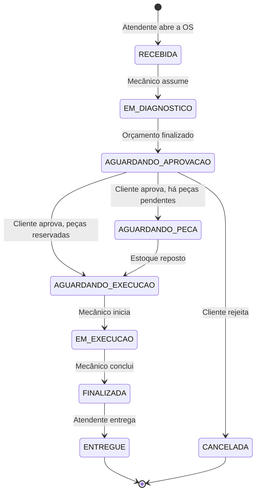

# SIAES - Sistema Integrado de Atendimento e Execução de Serviços

MVP de gestão de uma oficina mecânica, desenvolvido para o Tech Challenge da Fase 1 da pós-graduação SOAT (Software Architecture) da FIAP.

## Objetivo

Organizar o atendimento da oficina do primeiro contato com o cliente até a entrega do veículo. O sistema controla as ordens de serviço (OS), o orçamento, o estoque de peças e o acompanhamento pelo cliente, com regras de negócio explícitas, rastreabilidade de cada mudança de status e segurança no acesso às informações.

## Solução

A aplicação é uma API REST com duas frentes:

| Frente | Quem usa | Acesso | O que oferece |
| :--- | :--- | :--- | :--- |
| **Frente da Loja** | Atendente, Mecânico e Gerente | Autenticado por JWT, com permissões por perfil (RBAC) | Cadastro de clientes, veículos, serviços, peças e usuários; abertura e acompanhamento das OS; diagnóstico, orçamento, execução e entrega; relatórios de tempo médio |
| **Frente do Cliente** | Cliente da oficina | Público, identificado pelo número da OS junto com o CPF/CNPJ, com limite de requisições | Consulta do status da OS com a estimativa de entrega; aprovação ou rejeição do orçamento |

O centro do sistema é a **máquina de estados da OS**. Cada transição é feita por um método do agregado `OrdemServico`, que bloqueia as transições inválidas e grava um registro no histórico de status:



O Gerente também pode cancelar a OS de `RECEBIDA` até `EM_EXECUCAO`, informando o motivo.

Junto com a OS, o sistema cuida de:

- **Orçamento:** soma dos serviços e das peças com os preços congelados no momento do orçamento, para que uma mudança no catálogo não altere uma OS já orçada.
- **Estoque:** reserva das peças na conclusão do orçamento; registro das peças pendentes quando falta saldo; prioridade para a OS mais antiga quando o estoque é reposto; baixa no início da execução e estorno na rejeição ou no cancelamento. O saldo disponível nunca fica negativo.
- **Métricas:** horários de abertura, início da execução e finalização, usados na estimativa de entrega e no relatório de tempo médio de execução.

Os requisitos completos estão em [`docs/requisitos-funcionais.md`](docs/requisitos-funcionais.md) (RF-01 a RF-27) e [`docs/requisitos-nao-funcionais.md`](docs/requisitos-nao-funcionais.md) (RNF-01 a RNF-16).

## Arquitetura

O sistema é um **monólito em camadas** (RNF-01) modelado com **Domain-Driven Design**. O domínio fica isolado em Python puro, sem framework web, ORM nem biblioteca de JWT (RNF-02).

```text
src/
├── domain/           Regras de negócio: entidades, agregados, objetos de valor, eventos e portas de repositório
├── application/      Casos de uso que orquestram o domínio, portas de serviços técnicos e Event Dispatcher
├── infrastructure/   Adaptadores: PostgreSQL (SQLAlchemy), JWT, bcrypt e configuração
└── presentation/     API FastAPI: rotas, DTOs, autenticação das rotas e tratamento de erros
```

- **Regra de dependência:** as dependências apontam sempre para dentro, em direção ao domínio. O domínio não conhece as outras camadas, e os casos de uso dependem de interfaces (portas), não das implementações.
- **Portas e adaptadores:** cada dependência externa (banco, token, hash de senha) é uma interface no domínio ou na aplicação, com a implementação em `infrastructure/`. Só o `presentation/container.py` conhece as implementações e as monta.
- **Agregados:** `OrdemServico`, com os itens, o orçamento e o histórico de status, e `EstoquePeca`, com as quantidades física e reservada de cada peça.
- **Eventos de domínio:** quando a regra de um agregado precisa alterar o outro (por exemplo, a baixa do estoque ao iniciar a execução), o agregado emite um evento, e o Event Dispatcher síncrono chama o handler dentro da mesma transação.
- **Transações:** cada operação crítica roda em uma única unidade de trabalho, com rollback completo em caso de falha (RNF-08).

A arquitetura está documentada nos quatro níveis do [modelo C4](docs/ddd/c4-model.md) (contexto, contêineres, componentes e diagrama de classes). As regras de onde colocar cada parte do código estão no [guia de desenvolvimento](docs/guia-de-desenvolvimento.md).

## Tecnologias

| Área | Tecnologia |
| :--- | :--- |
| Linguagem | Python 3.12 |
| API | FastAPI e Uvicorn, com documentação OpenAPI (Swagger) em `/docs` |
| Banco de dados | PostgreSQL 16 |
| Acesso ao banco | SQLAlchemy 2.0 no modo assíncrono, com o driver asyncpg |
| Migrations | Alembic, aplicado na subida do contêiner |
| Configuração | pydantic-settings, com as variáveis lidas do ambiente (`.env`) |
| Autenticação | JWT com PyJWT e senhas com hash bcrypt |
| Rate limiting | SlowAPI, nas rotas públicas |
| Dependências | uv, com `pyproject.toml` e lockfile `uv.lock` |
| Testes | pytest, pytest-asyncio, pytest-cov e httpx |
| Lint e formatação | Ruff |
| Análise de vulnerabilidades | pip-audit (dependências), Bandit (código) e Trivy (imagem Docker) |
| Teste de desempenho | Locust |
| Execução | Docker (imagem multi-stage) e Docker Compose, com os serviços `app` e `db` |

## Banco de dados

O banco escolhido é o **PostgreSQL 16** (RNF-09), pelos seguintes motivos:

1. **Estrutura relacional forte.** Os dados formam vínculos rígidos: um cliente tem veículos, cada OS pertence a um cliente e a um veículo, e cada OS tem itens de serviço e de peça. O modelo relacional representa essas relações de forma natural.
2. **Integridade referencial.** Chaves estrangeiras e restrições de unicidade (como o documento do cliente e o e-mail do usuário) impedem que uma exclusão ou um dado duplicado corrompa o histórico de atendimentos e o estoque. A exclusão de clientes, veículos, serviços e peças é lógica, para preservar as OS antigas.
3. **Consistência atômica.** A reserva, a baixa e o estorno de peças alteram ao mesmo tempo a OS e o estoque. As transações ACID garantem que essas alterações aconteçam juntas ou não aconteçam (RNF-08), e o controle de concorrência impede que duas OS reservem o mesmo saldo.

O schema é versionado com o Alembic, em `migrations/`, e aplicado automaticamente antes da subida da API.

## Documentação

- [Requisitos funcionais](docs/requisitos-funcionais.md) e [não funcionais](docs/requisitos-nao-funcionais.md)
- [Event Storming (board no Miro e PDF)](docs/ddd/event-storming.md)
- [Linguagem ubíqua](docs/ddd/linguagem-ubiqua.md)
- [Modelo C4](docs/ddd/c4-model.md)
- [Guia de desenvolvimento](docs/guia-de-desenvolvimento.md)
