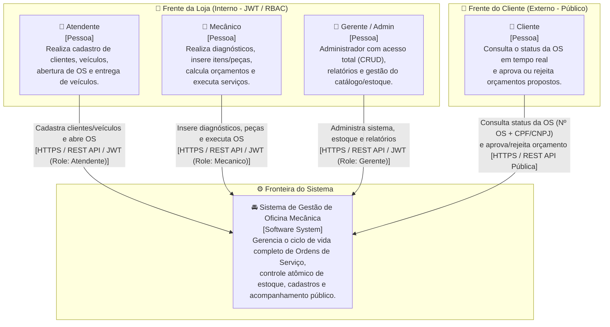
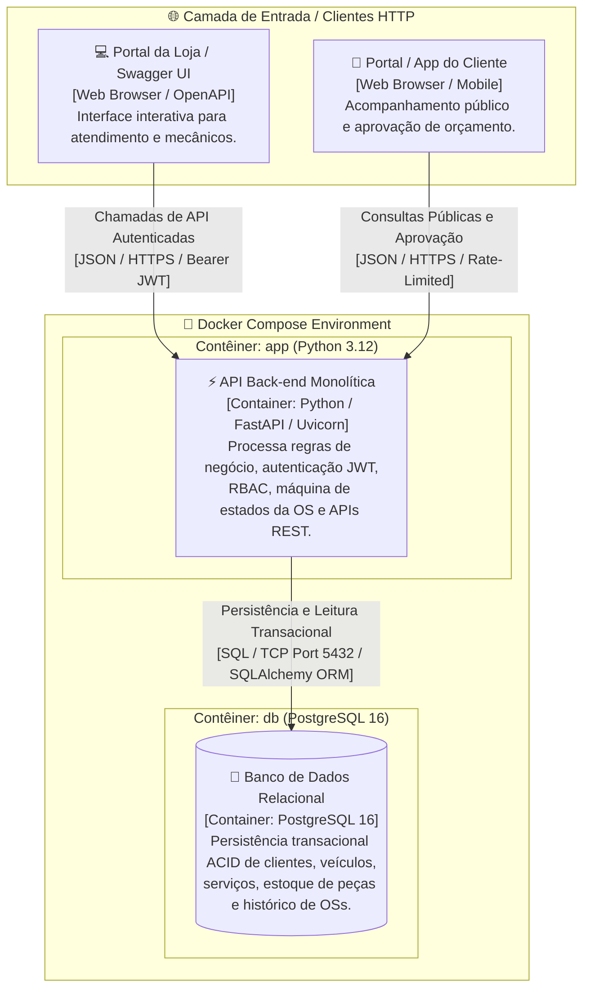

# Documentação de Arquitetura de Software - Modelo C4

> **Projeto:** Sistema de Gestão de Oficina Mecânica (Tech Challenge - Fase 1)  
> **Linguagem & Framework:** Python 3.12 / FastAPI / Uvicorn  
> **Banco de Dados:** PostgreSQL 16  
> **Padrão Arquitetural:** Monólito em Camadas (Layered Monolith) inspirado em Domain-Driven Design (DDD) e Clean Architecture  

---

## 1. Visão Geral do Modelo C4

O **Modelo C4** (criado por Simon Brown) é uma abordagem hierárquica e incremental para documentar a arquitetura de software em quatro níveis de abstração: **Contexto**, **Contêineres**, **Componentes** e **Código**. Esta estrutura permite comunicar a arquitetura de forma clara tanto para partes interessadas do negócio quanto para o time técnico de desenvolvimento.

```
Nível 1: Contexto (System Context) ---> Visão geral das pessoas e sistemas
Nível 2: Contêineres (Containers)  ---> Visão das aplicações e bancos de dados executáveis
Nível 3: Componentes (Components)  ---> Visão dos módulos internos da aplicação Python (src/presentation, application, domain, infrastructure)
Nível 4: Código (Code)             ---> Visão detalhada das classes de domínio, VOs e agregados
```

---

## 2. Nível 1: Diagrama de Contexto (System Context)

O Diagrama de Contexto apresenta o sistema como uma caixa-preta central, mapeando todas as personas e papéis que com ele interagem, divididos nas duas frentes da solução: **Frente da Loja** (acesso autenticado via RBAC) e **Frente do Cliente** (acompanhamento público desautenticado).

### Diagrama de Contexto (Mermaid)



### Relação de Atores e Escopo de Acesso

| Ator | Tipo de Acesso | Interface / Protocolo | Escopo Principal de Atuação |
| :--- | :--- | :--- | :--- |
| **Atendente** | Autenticado (JWT - `Atendente`) | API REST (HTTPS) | Abertura de OS, cadastro/vínculo de cliente e veículo, listagem de catálogo e entrega do veículo. |
| **Mecânico** | Autenticado (JWT - `Mecanico`) | API REST (HTTPS) | Diagnóstico técnico, inclusão de serviços/peças, cálculo de orçamento e execução da manutenção. |
| **Gerente (Admin)** | Autenticado (JWT - `Gerente`) | API REST (HTTPS) | Acesso total administrativo (CRUD amplo), cancelamento de OS com motivo e relatórios de tempos médios. |
| **Cliente** | Público (Sem JWT) | API REST (HTTPS) | Consulta de status em tempo real (Nº OS + CPF/CNPJ), visualização do orçamento e aprovação/rejeição. |

---

## 3. Nível 2: Diagrama de Contêineres (Container Diagram)

O Diagrama de Contêineres detalha as unidades de implantação executáveis (contêineres Docker) que compõem a arquitetura do monólito, seus protocolos de comunicação e escolhas de tecnologia.

### Diagrama de Contêineres (Mermaid)



### Detalhamento dos Contêineres

| Contêiner | Tecnologia | Função e Responsabilidade | Protocolos & Portas |
| :--- | :--- | :--- | :--- |
| **API Back-end (`app`)** | Python 3.12, FastAPI, Uvicorn | Expor endpoints RESTful, validar tokens JWT e permissões RBAC, executar casos de uso, orquestrar a máquina de estados da OS e sanitizar dados de entrada. | HTTP/JSON (Porta 8000) |
| **Banco de Dados (`db`)** | PostgreSQL 16 | Armazenamento relacional persistente com suporte a transações ACID, garantindo integridade referencial e baixa atômica de estoque. | SQL/TCP (Porta 5432) |
| **Orquestrador Local** | Docker Compose v2 | Orquestra e inicializa os contêineres `app` e `db` em rede isolada para execução local determinística. | Docker Network |

---

## 4. Nível 3: Diagrama de Componentes (Component Diagram)

O Diagrama de Componentes descreve a organização interna do contêiner da aplicação Python, evidenciando o desacoplamento das camadas da **Clean / Layered Architecture** com a entrada centralizada em `src/presentation/`.

### Diagrama de Componentes (Mermaid)

```mermaid
flowchart TD
    subgraph API_LAYER ["1. Camada de Apresentação / Entrada (src/presentation/)"]
        RouterAutenticacao["🔐 routers/autenticacao.py\nRota pública de login e emissão do JWT."]
        RouterOS["🛠️ routers/ordens_servico.py\nRotas administrativas de OS (Criar, Listar, Transicionar)."]
        RouterClientes["👤 routers/clientes.py\nRotas de CRUD de Clientes."]
        RouterVeiculos["🚗 routers/veiculos.py\nRotas de CRUD de Veículos."]
        RouterEstoque["📦 routers/estoque.py\nRotas de gestão e entrada de estoque de peças."]
        RouterAcompanhamento["📲 routers/acompanhamento_publico.py\nRota desautenticada de consulta por número da OS e CPF/CNPJ."]
        
        Dependencies["🛡️ middlewares/dependencies.py\nobter_usuario_autenticado e exigir_perfis validam o token Bearer\ne a claim 'role' (Atendente, Mecanico, Gerente)."]
        RateLimit["⚡ middlewares/rate_limit.py\nlimiter do SlowAPI nas rotas públicas contra força bruta."]
    end

    subgraph APPLICATION ["2. Camada de Aplicação (src/application/)"]
        CriarOS["⚙️ CriarOS"]
        AtribuirMecanico["⚙️ AtribuirMecanico"]
        FinalizarOrcamento["⚙️ FinalizarOrcamento"]
        AprovarOrcamento["⚙️ AprovarOrcamento"]
        IniciarExecucao["⚙️ IniciarExecucao"]
        ConsultarOSPublica["⚙️ ConsultarOSPublica"]
        LocalizarOSDoTitular["⚙️ LocalizarOSDoTitular\nNúmero da OS + CPF/CNPJ do titular."]
        
        Ports["🔌 Portas de Serviço (application/ports/)\nTokenService, PasswordHasher"]
        EventDispatcher["⚡ EventDispatcher (In-Memory)\nBarramento síncrono para eventos de domínio."]
        ReservaHandler["📦 ReservaPecasHandler\nEscuta OrcamentoFinalizadoEvent e reserva as peças da OS."]
        EstornoHandler["📦 EstornoPecasHandler\nEscuta OSCanceladaEvent e estorna as reservas da OS."]
        EstoqueHandler["📦 BaixaEstoqueHandler\nEscuta ExecucaoIniciadaEvent e efetua a baixa das peças reservadas."]
        AlocacaoHandler["📦 AlocacaoPecasPendentesHandler\nEscuta SaldoPecaAtualizadoEvent, aloca o saldo às OS pendentes\ne libera as OS sem pendência."]
    end

    subgraph DOMAIN ["3. Camada de Domínio (src/domain/ - Pure Python Dataclasses)"]
        AggOS[("🟩 Agregado: OrdemServico\nEntidade-raiz com regras da máquina de estados.")]
        AggEstoque[("🟩 Agregado: EstoquePeca\nEntidade com controle quantitativo.")]
        Entities["👤 Entidades\nCliente, Veiculo, Usuario, Servico, Peca."]
        VOs["💎 Value Objects\nDocumento, CPF, CNPJ, Placa, Valor, NumeroOS, Orcamento,\nStatusOS, PerfilUsuario, OrigemTransicao."]
        DomainEvents["🟧 Eventos de Domínio\nOrcamentoFinalizadoEvent, OSCanceladaEvent,\nExecucaoIniciadaEvent, SaldoPecaAtualizadoEvent."]
        Repositories["🔌 Portas de Repositório (ABCs)\nOrdemServicoRepository, EstoqueRepository, UsuarioRepository,\nClienteRepository, VeiculoRepository."]
    end

    subgraph INFRASTRUCTURE ["4. Camada de Infraestrutura (src/infrastructure/)"]
        PgOSRepo["🐘 PostgresOrdemServicoRepository\nImplementação concreta SQLAlchemy."]
        PgEstoqueRepo["🐘 PostgresEstoqueRepository\nImplementação concreta SQLAlchemy com Lock."]
        PgCadastroRepo["🐘 PostgresClienteRepository, PostgresVeiculoRepository\nImplementações concretas SQLAlchemy."]
        JwtTokenService["🔐 JwtTokenService\nImplementação de TokenService com PyJWT."]
        BcryptHasher["🔐 BcryptPasswordHasher\nImplementação de PasswordHasher."]
        PgDatabase["🐘 SQLAlchemy Session / Postgres Driver"]
    end

    Dependencies --> RouterOS
    Dependencies --> RouterClientes
    Dependencies --> RouterVeiculos
    Dependencies --> RouterEstoque
    RateLimit --> RouterAcompanhamento
    
    RouterOS --> CriarOS
    RouterOS --> AtribuirMecanico
    RouterOS --> FinalizarOrcamento
    RouterOS --> IniciarExecucao
    RouterAcompanhamento --> AprovarOrcamento
    RouterAcompanhamento --> ConsultarOSPublica
    ConsultarOSPublica --> LocalizarOSDoTitular
    AprovarOrcamento --> LocalizarOSDoTitular
    LocalizarOSDoTitular --> Repositories
    
    AprovarOrcamento --> AggOS
    IniciarExecucao --> AggOS
    FinalizarOrcamento --> EventDispatcher
    IniciarExecucao --> EventDispatcher
    AggOS -.->|emite| DomainEvents
    AggEstoque -.->|emite| DomainEvents
    EventDispatcher -->|OrcamentoFinalizadoEvent| ReservaHandler
    EventDispatcher -->|OSCanceladaEvent| EstornoHandler
    EventDispatcher -->|ExecucaoIniciadaEvent| EstoqueHandler
    EventDispatcher -->|SaldoPecaAtualizadoEvent| AlocacaoHandler
    ReservaHandler --> AggEstoque
    ReservaHandler --> AggOS
    EstornoHandler --> AggEstoque
    EstoqueHandler --> AggEstoque
    AlocacaoHandler --> AggEstoque
    AlocacaoHandler --> AggOS
    ReservaHandler --> Repositories
    EstornoHandler --> Repositories
    EstoqueHandler --> Repositories
    AlocacaoHandler --> Repositories
    
    CriarOS --> Repositories
    AprovarOrcamento --> Repositories
    
    JwtTokenService -.->|Implementa| Ports
    BcryptHasher -.->|Implementa| Ports
    PgOSRepo -.->|Implementa| Repositories
    PgEstoqueRepo -.->|Implementa| Repositories
    PgOSRepo --> PgDatabase
    PgEstoqueRepo --> PgDatabase
```



---

## 5. Nível 4: Diagrama de Código (Code Diagram)

O Diagrama de Código ilustra a estrutura interna dos agregados (`OrdemServico`, `EstoquePeca`), das entidades (`Cliente`, `Veiculo`, `Usuario`, `Servico`, `Peca`, `ItemServico`, `ItemPeca`, `HistoricoStatusOS`), dos Objetos de Valor (`Documento`, `CPF`, `CNPJ`, `Placa`, `Valor`, `NumeroOS`, `Orcamento`, `StatusOS`, `PerfilUsuario`, `OrigemTransicao`, `PendenciaPeca`, `AlocacaoPeca`) e dos Eventos de Domínio, implementados como **`dataclasses` puras do Python** sem acoplamento com frameworks. Todo preço e todo total usa o objeto de valor `Valor`, com precisão decimal (RNF-11).

### Diagrama de Classes do Domínio (Mermaid / UML)

```mermaid
classDiagram
    class Cliente {
        +UUID id
        +str nome
        +Documento documento
        +str email
        +str telefone
        +bool ativo
    }

    class Veiculo {
        +UUID id
        +UUID cliente_id
        +Placa placa
        +str marca
        +str modelo
        +int ano
        +bool ativo
    }

    class Usuario {
        +UUID id
        +str nome
        +str email
        +str senha_hash
        +PerfilUsuario perfil
        +bool ativo
    }

    class PerfilUsuario {
        <<enumeration>>
        ATENDENTE
        MECANICO
        GERENTE
    }

    class StatusOS {
        <<enumeration>>
        RECEBIDA
        EM_DIAGNOSTICO
        AGUARDANDO_APROVACAO
        AGUARDANDO_PECA
        AGUARDANDO_EXECUCAO
        EM_EXECUCAO
        FINALIZADA
        ENTREGUE
        CANCELADA
    }

    class OrdemServico {
        +UUID id
        +NumeroOS numero
        +UUID cliente_id
        +UUID veiculo_id
        +UUID atendente_id
        +Optional~UUID~ mecanico_id
        +StatusOS status
        +List~ItemServico~ servicos
        +List~ItemPeca~ pecas
        +datetime data_abertura
        +Optional~datetime~ data_inicio_execucao
        +Optional~datetime~ data_finalizacao
        +Optional~Orcamento~ orcamento
        +Tuple~HistoricoStatusOS~ historico
        +List~DomainEvent~ _domain_events
        +abrir(numero: NumeroOS, cliente_id: UUID, veiculo_id: UUID, atendente_id: UUID) OrdemServico
        +atribuir_mecanico(mecanico: Usuario, responsavel: Usuario) void
        +incluir_servico(servico: Servico) void
        +incluir_peca(peca: Peca, quantidade: int) void
        +remover_servico(servico_id: UUID) void
        +remover_peca(peca_id: UUID) void
        +congelar_valores(servicos_vigentes: List~Servico~, pecas_vigentes: List~Peca~) void
        +finalizar_orcamento(usuario_id: UUID, servicos_vigentes: List~Servico~, pecas_vigentes: List~Peca~) void
        +aprovar_orcamento() void
        +rejeitar_orcamento() void
        +alocar_peca(peca_id: UUID, quantidade: int) void
        +liberar_para_execucao() void
        +iniciar_execucao(usuario: Usuario) void
        +concluir_manutencao(usuario_id: UUID) void
        +entregar_veiculo(usuario_id: UUID) void
        +cancelar(usuario_id: UUID, motivo: str) void
        +estimar_entrega(momento_consulta: datetime) Optional~datetime~
        +collect_domain_events() List~DomainEvent~
    }

    class ItemServico {
        +UUID servico_id
        +str nome
        +Valor preco_congelado
        +int tempo_estimado_minutos
        +congelar(servico: Servico) void
    }

    class ItemPeca {
        +UUID peca_id
        +str nome
        +int quantidade
        +int quantidade_reservada
        +int quantidade_pendente
        +Valor preco_unitario_congelado
        +int prazo_reposicao_dias
        +valor_total() Valor
        +congelar(peca: Peca) void
        +marcar_como_pendente() void
    }

    class Orcamento {
        <<Value Object>>
        +Valor subtotal_servicos
        +Valor subtotal_pecas
        +Valor total
    }

    class HistoricoStatusOS {
        +UUID id
        +Optional~StatusOS~ status_anterior
        +StatusOS status_novo
        +datetime data_hora
        +OrigemTransicao origem
        +Optional~UUID~ usuario_id
        +Optional~str~ motivo
    }

    class OrigemTransicao {
        <<enumeration>>
        USUARIO
        CLIENTE
        SISTEMA
    }

    class Servico {
        +UUID id
        +str codigo
        +str nome
        +str descricao
        +Valor valor_base
        +int tempo_estimado_minutos
        +bool ativo
    }

    class Peca {
        +UUID id
        +str codigo_referencia
        +str nome
        +Valor preco_unitario
        +int prazo_reposicao_dias
        +bool ativo
    }

    class EstoquePeca {
        +UUID peca_id
        +int quantidade_fisica
        +int quantidade_reservada
        +List~DomainEvent~ _domain_events
        +saldo_disponivel() int
        +reservar(quantidade: int) tuple
        +alocar_pendencias(pendencias: List~PendenciaPeca~) List~AlocacaoPeca~
        +baixar(quantidade: int) void
        +estornar(quantidade: int) void
        +repor(quantidade: int) void
        +ajustar_quantidade_fisica(nova_quantidade: int) void
        +collect_domain_events() List~DomainEvent~
    }

    class PendenciaPeca {
        <<Value Object>>
        +UUID os_id
        +datetime data_abertura_os
        +int quantidade_pendente
    }

    class AlocacaoPeca {
        <<Value Object>>
        +UUID os_id
        +int quantidade_reservada
    }

    class QuantidadePeca {
        <<Value Object>>
        +UUID peca_id
        +int quantidade
    }

    class Valor {
        <<Value Object>>
        +Decimal valor
        +somar(outro: Valor) Valor
        +multiplicar(quantidade: int) Valor
    }

    class NumeroOS {
        <<Value Object>>
        +str valor
    }

    class Documento {
        <<abstract>>
        +str valor
        +tres_primeiros_digitos() str
    }

    class CPF {
        <<Value Object>>
    }

    class CNPJ {
        <<Value Object>>
    }

    class Placa {
        <<Value Object>>
        +str valor
        +eh_mercosul() bool
    }

    class DomainEvent {
        <<interface>>
        +str event_id
        +datetime occurred_on
    }

    class OrcamentoFinalizadoEvent {
        +UUID os_id
    }

    class OSCanceladaEvent {
        +UUID os_id
        +List~QuantidadePeca~ estornos
    }

    class ExecucaoIniciadaEvent {
        +UUID os_id
        +List~QuantidadePeca~ baixas
    }

    class SaldoPecaAtualizadoEvent {
        +UUID peca_id
        +int saldo_disponivel
    }

    Usuario "1" --> "1" PerfilUsuario : possui
    Cliente --> Documento : documento
    Documento <|-- CPF : pessoa física
    Documento <|-- CNPJ : pessoa jurídica
    NumeroOS ..> Documento : usa tres_primeiros_digitos
    Veiculo "*" --> "1" Cliente : pertence a (cliente_id)
    OrdemServico "*" --> "1" Cliente : referencia (cliente_id)
    OrdemServico "*" --> "1" Veiculo : referencia (veiculo_id)
    OrdemServico "*" --> "1" Usuario : atendente (atendente_id)
    OrdemServico "*" --> "0..1" Usuario : mecanico (mecanico_id)
    OrdemServico "1" *-- "*" ItemServico : contem
    OrdemServico "1" *-- "*" ItemPeca : contem
    OrdemServico --> StatusOS : possui estado
    OrdemServico --> NumeroOS : numero
    OrdemServico "1" *-- "0..1" Orcamento : orcamento
    OrdemServico "1" *-- "*" HistoricoStatusOS : historico
    HistoricoStatusOS --> OrigemTransicao : origem
    ItemServico "*" --> "1" Servico : referencia (servico_id)
    ItemPeca "*" --> "1" Peca : referencia (peca_id)
    EstoquePeca "1" --> "1" Peca : controla o estoque de (peca_id)
    ItemServico --> Valor : preco_congelado
    ItemPeca --> Valor : preco_unitario_congelado
    Servico --> Valor : valor_base
    Peca --> Valor : preco_unitario
    Orcamento --> Valor : subtotais e total
    DomainEvent <|-- OrcamentoFinalizadoEvent : herda de
    DomainEvent <|-- OSCanceladaEvent : herda de
    DomainEvent <|-- ExecucaoIniciadaEvent : herda de
    DomainEvent <|-- SaldoPecaAtualizadoEvent : herda de
    OrdemServico *-- DomainEvent : acumula eventos
    EstoquePeca *-- DomainEvent : acumula eventos
    EstoquePeca ..> PendenciaPeca : recebe
    EstoquePeca ..> AlocacaoPeca : devolve
    OSCanceladaEvent --> QuantidadePeca : estornos
    ExecucaoIniciadaEvent --> QuantidadePeca : baixas
```



### Decisões do Diagrama de Classes

* **`Peca` e `EstoquePeca` são entidades separadas, na relação 1:1.** `Peca` guarda o cadastro (código de referência, nome, preço unitário, prazo de reposição e exclusão lógica), alterado só pelo Gerente (RF-12). `EstoquePeca` é a raiz do agregado de estoque e guarda as quantidades física e reservada. A separação faz a reserva, a baixa e o estorno bloquearem apenas o registro de estoque, sem disputar o registro do cadastro.
* **Tempo estimado e prazo de reposição são congelados no item.** Na inclusão do item e, de novo, em `finalizar_orcamento` (com os valores vigentes do catálogo), junto com os preços (RF-17), a OS copia `Servico.tempo_estimado_minutos` para `ItemServico` e `Peca.prazo_reposicao_dias` para `ItemPeca`. Assim, `estimar_entrega` (RF-25) usa só os dados da OS, e a estimativa corresponde ao orçamento apresentado ao cliente. Uma alteração posterior no catálogo não muda a estimativa das OS já orçadas.
* **Estimativa de entrega.** `estimar_entrega(momento_consulta)` segue a tabela do RF-25 e devolve data e hora com fuso, ou nada nos status `RECEBIDA`, `EM_DIAGNOSTICO` e `CANCELADA`. A duração soma os tempos estimados dos serviços, e o prazo das peças é o maior entre os itens com quantidade pendente (peça já reservada não conta). O momento da consulta vem de fora, para o cálculo ser testável, e deve ter fuso horário. Uma OS em `EM_EXECUCAO` sem início registrado, ou em `FINALIZADA` ou `ENTREGUE` sem finalização registrada, é um agregado inconsistente e levanta `OrdemServicoInvalida`, assim como prazos que estouram o limite de datas; o caso de uso da consulta pública precisa tratar esse erro.
* **A OS não consulta o catálogo.** `congelar_valores` recebe do caso de uso o `Servico` e a `Peca` vigentes de cada item, atualiza os valores congelados e calcula o `Orcamento`; recusa com `ItemIndisponivel`, sem alterar nenhum item, o serviço ou a peça excluída do catálogo depois de incluída; `finalizar_orcamento(usuario_id, servicos_vigentes, pecas_vigentes)` o chama antes da transição, depois de validar o status de origem. Os itens só mudam em `EM_DIAGNOSTICO` (RF-17), e a OS recusa itens inativos, o mesmo serviço ou peça repetidos e peça com quantidade que não seja um inteiro maior que zero. `Orcamento` guarda os subtotais de serviços e de peças e calcula o total na criação. Incluir ou remover um item descarta o orçamento já calculado, para ele nunca contradizer os itens, e os valores só ficam definitivos quando a OS sai do diagnóstico e os itens deixam de mudar.
* **Documento do cliente.** `CPF` e `CNPJ` são objetos de valor separados, por decisão do grupo na issue #14, e herdam da base abstrata `Documento`. A base guarda só os dígitos, aplica o cálculo do módulo 11 com o tamanho e os pesos de cada subclasse e expõe `tres_primeiros_digitos()`, usado no número da OS (RF-05, RF-13). `Cliente.documento` é do tipo `Documento`, e por isso `Cliente` e a consulta pública (RF-25) trabalham com um só tipo.
* **Transições e quem as executa.** Cada método da máquina de estados declara de quais status parte, e só `_mudar_status` altera o `status`, o ponto onde o histórico e os eventos se encaixam. `atribuir_mecanico` recebe o mecânico e o responsável como `Usuario`: o Mecânico só atribui a OS a si mesmo e o Gerente a qualquer mecânico (outro responsável recebe `AcessoNegado`, `403`), o indicado precisa ser um mecânico ativo (`MecanicoIndisponivel`, `422`) e o histórico grava o responsável, que executa a transição. `iniciar_execucao` recebe o `Usuario` e só aceita o mecânico atribuído à OS ou o Gerente; outro usuário recebe `AcessoNegado` (`403`). `liberar_para_execucao` recusa a OS que ainda tem peça pendente (`PecasPendentes`), e `cancelar` exige o motivo (`MotivoObrigatorio`). `rejeitar_orcamento` e `cancelar` descartam as pendências dos itens (RF-18), e as quantidades reservadas ficam até o estorno devolvê-las ao estoque, porque o `OSCanceladaEvent` as usa para calcular as quantidades a estornar. `iniciar_execucao` também recusa o usuário desativado (`AcessoNegado`). `finalizar_orcamento` deixa toda a quantidade de cada `ItemPeca` pendente, e a reserva de estoque converte a pendente em reservada (RF-18). A conferência do perfil (Mecânico, Gerente, Atendente) de cada operação fica na camada `presentation`.
* **Histórico de status.** `_mudar_status` é o único ponto que altera o `status` e grava um `HistoricoStatusOS` por transição, com o mesmo instante de `data_inicio_execucao` e `data_finalizacao`. A origem segue a coluna "Quem executa" da Linguagem Ubíqua: as transições feitas por Mecânico, Gerente ou Atendente gravam `USUARIO` e o `usuario_id` (por isso os métodos recebem o usuário como primeiro parâmetro); `aprovar_orcamento` e `rejeitar_orcamento` gravam `CLIENTE` e `liberar_para_execucao` grava `SISTEMA`, ambos sem usuário. O registro da abertura nasce na fábrica `OrdemServico.abrir`, sem status anterior e com o atendente como usuário; o construtor só reconstitui uma OS e nunca inventa registro, por isso o adaptador de persistência precisa carregar o histórico completo e em ordem (o construtor recusa um histórico que não seja uma sequência de registros, que não esteja encadeado ou que não termine no status da OS). `cancelar` grava o motivo. Os registros são imutáveis (`dataclass` congelada), com data e hora com fuso horário, e o `historico` da OS é uma tupla somente leitura: só os métodos de transição o ampliam, e nada o altera nem remove (RF-24).
* **Prioridade pela OS mais antiga.** `EstoquePeca.alocar_pendencias` recebe as pendências da peça, ordena pela data de abertura da OS e reserva o saldo da mais antiga para a mais nova (RF-18, RF-19). A conclusão do orçamento (o `ReservaPecasHandler`, que inclui a OS nova entre as pendências, depois das OS que já esperam a peça) e o aumento de saldo usam o mesmo método, e `OrdemServico.alocar_peca` converte a quantidade pendente do item em reservada por `ItemPeca.alocar`, que recusa quantidade acima da pendente. A OS em `AGUARDANDO_PECA` que fica sem pendência passa a `AGUARDANDO_EXECUCAO` (origem `SISTEMA`); em `AGUARDANDO_APROVACAO` a reserva não muda o status, e o cliente ainda decide sobre o orçamento. Uma alocação recusada não altera a OS, e o método não emite evento. O método ordena de forma estável (no empate de data vale a ordem recebida), reserva cada pendência com `reservar` e devolve só as OS que receberam alguma quantidade; não emite evento, porque a reserva não aumenta o saldo. Valida a lista inteira antes de reservar: uma pendência de tipo errado ou duas da mesma OS (`AlocacaoInvalida`) não deixam reserva nenhuma. A `PendenciaPeca` exige a data de abertura com fuso horário.
* **Estorno e baixa.** `cancelar` e `rejeitar_orcamento` calculam as quantidades a estornar a partir do status da OS e as enviam em `OSCanceladaEvent.estornos`. A OS cancelada em `EM_EXECUCAO` envia a lista vazia, porque `iniciar_execucao` já deu baixa em todas as reservas (RF-20); por isso `ItemPeca` não guarda quantidade baixada.
* **Reserva e limites do estoque.** `reservar` reserva o menor valor entre o pedido e o saldo disponível e devolve o par (reservada, pendente); `OrdemServico.alocar_peca` e `alocar_pendencias` o usam. `baixar` e `estornar` aceitam no máximo a quantidade reservada, e quantidade que não seja um inteiro maior que zero é recusada. Nenhuma operação deixa a reservada acima da física nem o saldo negativo, e quando é recusada não altera o estado. `SaldoPecaAtualizadoEvent` leva o `peca_id` e o saldo disponível do instante da operação; como duas operações na mesma transação geram dois eventos, o handler e `alocar_pendencias` usam o saldo atual do agregado, não o do evento. Só `repor`, `estornar` e o ajuste para cima o acumulam; `baixar` e `reservar` não aumentam o saldo.
* **Ajuste de estoque.** `ajustar_quantidade_fisica` corrige a quantidade física para perda, quebra ou inventário (RF-12). O valor novo não pode ficar abaixo da quantidade reservada, e o método emite `SaldoPecaAtualizadoEvent` só quando o saldo disponível aumenta.
* **Eventos de domínio.** O diagrama mostra os 4 eventos do catálogo da seção 7 de `docs/ddd/event-storming.md`, com o identificador do agregado emissor e as quantidades que o consumidor precisa. `OrdemServico` e `EstoquePeca` acumulam os eventos e os entregam por `collect_domain_events()`, que esvazia a lista; só uma transição ou operação concluída acumula evento. O `OSCanceladaEvent` leva em `estornos`, e o `ExecucaoIniciadaEvent` leva em `baixas`, a quantidade reservada de cada peça (a lista de estornos vai vazia no cancelamento em `EM_EXECUCAO`); `QuantidadePeca` recusa quantidade que não seja inteiro maior que zero, por isso as peças sem reserva ficam fora das listas.

---

## 6. Rastreabilidade da Arquitetura com a Estrutura de Pastas no Código

A estrutura física do repositório reflete exatamente o desacoplamento proposto pelo C4 Model e pelo DDD:

```text
src/
├── presentation/                  # Nível 3 (Camada de Entrada, Routers HTTP & Middlewares)
│   ├── main.py                    # Criação do app FastAPI e registro dos routers
│   ├── container.py               # Montagem das dependências (único ponto que importa infrastructure)
│   ├── routers/                   # Routers FastAPI, um arquivo por recurso (autenticacao, ordens_servico, clientes, estoque, acompanhamento_publico)
│   ├── middlewares/               # JWT Auth & Rate Limiting Guards (Depends / Security)
│   └── schemas/                   # Pydantic DTOs, um arquivo por recurso (Validação de Entrada/Saída HTTP)
├── application/                   # Nível 3 (Camada de Aplicação & Casos de Uso)
│   ├── use_cases/                 # Serviços de Orquestração (CriarOS, AprovarOrcamento, AutenticarUsuario)
│   ├── ports/                     # Interfaces Abstratas de Serviços (TokenService, PasswordHasher)
│   ├── events/                    # Event Dispatcher In-Memory
│   └── handlers/                  # Event Handlers (ReservaPecasHandler, EstornoPecasHandler, BaixaEstoqueHandler, AlocacaoPecasPendentesHandler)
├── domain/                        # Nível 4 (Núcleo Puro de Negócio em Python Dataclasses)
│   ├── entities/                  # Dataclasses de Agregados e Entidades (OrdemServico, EstoquePeca, Cliente, Veiculo, Usuario, Servico, Peca)
│   ├── value_objects/             # VOs Imutáveis (Documento, CPF, CNPJ, Placa, Valor, NumeroOS, Orcamento, StatusOS, PerfilUsuario, OrigemTransicao, PendenciaPeca, AlocacaoPeca)
│   ├── events/                    # Eventos de Domínio (catálogo na seção 7 de docs/ddd/event-storming.md)
│   └── repositories/              # Interfaces Abstratas dos Repositórios (ABCs)
└── infrastructure/                # Nível 3 (Adaptadores I/O & Infraestrutura)
    ├── config.py                  # Leitura e validação das variáveis de ambiente (pydantic-settings)
    ├── database/                  # Engine SQLAlchemy, Sessions, Unidade de Trabalho e Modelos do ORM
    ├── repositories/              # Implementações Concretas com SQLAlchemy (Postgres)
    └── security/                  # Implementações Concretas de Segurança (JwtTokenService com PyJWT, BcryptPasswordHasher com bcrypt)
```

> A árvore acima foi aprovada pelo grupo na issue #9 e coincide com as seções 2 e 3 de `docs/guia-de-desenvolvimento.md`. As migrations do Alembic ficam na pasta `migrations/`, na raiz do projeto.
