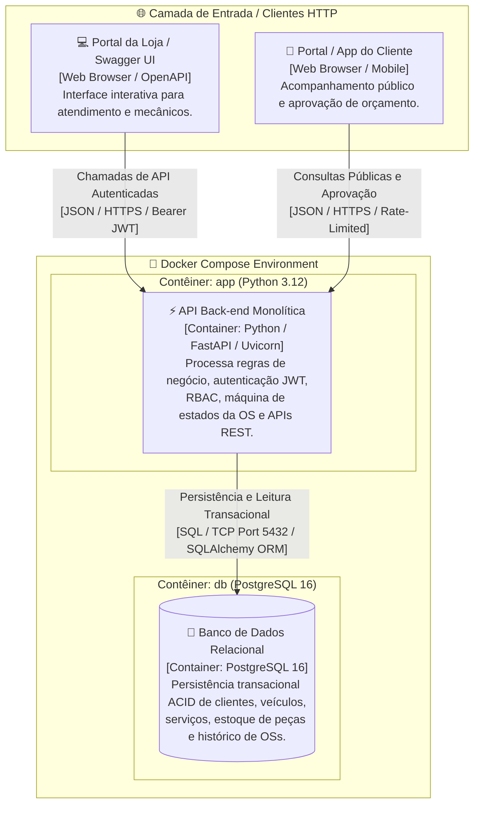

# Documentação de Arquitetura de Software - Modelo C4

> **Projeto:** Sistema de Gestão de Oficina Mecânica (Tech Challenge - Fase 1)  
> **Linguagem & Framework:** Python 3.12 / FastAPI / Uvicorn  
> **Banco de Dados:** PostgreSQL 16  
> **Padrão Arquitetural:** Monólito em Camadas (Layered Monolith) inspirado em Domain-Driven Design (DDD) e Clean Architecture  

---

## 1. Visão Geral do Modelo C4

O **Modelo C4** (criado por Simon Brown) é uma abordagem hierárquica e incremental para documentar a arquitetura de software em quatro níveis de abstração: **Contexto**, **Contêineres**, **Componentes** e **Código**. Esta estrutura permite comunicar a arquitetura de forma clara tanto para partes interessadas do negócio quanto para o time técnico de desenvolvimento.

```
Nível 1: Contexto (System Context) ---> Visão geral das pessoas e sistemas
Nível 2: Contêineres (Containers)  ---> Visão das aplicações e bancos de dados executáveis
Nível 3: Componentes (Components)  ---> Visão dos módulos internos da aplicação Python (src/presentation, application, domain, infrastructure)
Nível 4: Código (Code)             ---> Visão detalhada das classes de domínio, VOs e agregados
```

---

## 2. Nível 1: Diagrama de Contexto (System Context)

O Diagrama de Contexto apresenta o sistema como uma caixa-preta central, mapeando todas as personas e papéis que com ele interagem, divididos nas duas frentes da solução: **Frente da Loja** (acesso autenticado via RBAC) e **Frente do Cliente** (acompanhamento público desautenticado).

### Diagrama de Contexto (Mermaid)

```mermaid
flowchart TD
    subgraph ATORES_LOJA ["🏢 Frente da Loja (Interno - JWT / RBAC)"]
        Atendente["👤 Atendente\n[Pessoa]\nRealiza cadastro de clientes, veículos,\nabertura de OS e entrega de veículos."]
        Mecanico["👤 Mecânico\n[Pessoa]\nRealiza diagnósticos, insere itens/peças,\ncalcula orçamentos e executa serviços."]
        Gerente["👤 Gerente / Admin\n[Pessoa]\nAdministrador com acesso total (CRUD),\nrelatórios e gestão do catálogo/estoque."]
    end

    subgraph SISTEMA ["⚙️ Fronteira do Sistema"]
        OficinaSystem["🚘 Sistema de Gestão de Oficina Mecânica\n[Software System]\nGerencia o ciclo de vida completo de Ordens de Serviço,\ncontrole atômico de estoque, cadastros e acompanhamento público."]
    end

    subgraph ATORES_CLIENTE ["📲 Frente do Cliente (Externo - Público)"]
        Cliente["👤 Cliente\n[Pessoa]\nConsulta o status da OS em tempo real\ne aprova ou rejeita orçamentos propostos."]
    end

    Atendente -->|"Cadastra clientes/veículos e abre OS\n[HTTPS / REST API / JWT (Role: Atendente)]"| OficinaSystem
    Mecanico -->|"Insere diagnósticos, peças e executa OS\n[HTTPS / REST API / JWT (Role: Mecanico)]"| OficinaSystem
    Gerente -->|"Administra sistema, estoque e relatórios\n[HTTPS / REST API / JWT (Role: Gerente)]"| OficinaSystem
    Cliente -->|"Consulta status da OS (Nº OS + CPF/CNPJ)\ne aprova/rejeita orçamento [HTTPS / REST API Pública]"| OficinaSystem
```



### Relação de Atores e Escopo de Acesso

| Ator | Tipo de Acesso | Interface / Protocolo | Escopo Principal de Atuação |
| :--- | :--- | :--- | :--- |
| **Atendente** | Autenticado (JWT - `Atendente`) | API REST (HTTPS) | Abertura de OS, cadastro/vínculo de cliente e veículo, listagem de catálogo e entrega do veículo. |
| **Mecânico** | Autenticado (JWT - `Mecanico`) | API REST (HTTPS) | Diagnóstico técnico, inclusão de serviços/peças, cálculo de orçamento e execução da manutenção. |
| **Gerente (Admin)** | Autenticado (JWT - `Gerente`) | API REST (HTTPS) | Acesso total administrativo (CRUD amplo), cancelamento de OS com motivo e relatórios de tempos médios. |
| **Cliente** | Público (Sem JWT) | API REST (HTTPS) | Consulta de status em tempo real (Nº OS + CPF/CNPJ), visualização do orçamento e aprovação/rejeição. |

---

## 3. Nível 2: Diagrama de Contêineres (Container Diagram)

O Diagrama de Contêineres detalha as unidades de implantação executáveis (contêineres Docker) que compõem a arquitetura do monólito, seus protocolos de comunicação e escolhas de tecnologia.

### Diagrama de Contêineres (Mermaid)



### Detalhamento dos Contêineres

| Contêiner | Tecnologia | Função e Responsabilidade | Protocolos & Portas |
| :--- | :--- | :--- | :--- |
| **API Back-end (`app`)** | Python 3.12, FastAPI, Uvicorn | Expor endpoints RESTful, validar tokens JWT e permissões RBAC, executar casos de uso, orquestrar a máquina de estados da OS e sanitizar dados de entrada. | HTTP/JSON (Porta 8000) |
| **Banco de Dados (`db`)** | PostgreSQL 16 | Armazenamento relacional persistente com suporte a transações ACID, garantindo integridade referencial e baixa atômica de estoque. | SQL/TCP (Porta 5432) |
| **Orquestrador Local** | Docker Compose v2 | Orquestra e inicializa os contêineres `app` e `db` em rede isolada para execução local determinística. | Docker Network |

---

## 4. Nível 3: Diagrama de Componentes (Component Diagram)

O Diagrama de Componentes descreve a organização interna do contêiner da aplicação Python, evidenciando o desacoplamento das camadas da **Clean / Layered Architecture** com a entrada centralizada em `src/presentation/`.

### Diagrama de Componentes (Mermaid)

```mermaid
flowchart TD
    subgraph API_LAYER ["1. Camada de Apresentação / Entrada (src/presentation/)"]
        AuthController["🔐 AuthController\nEndpoints de login e geração de JWT."]
        OSController["🛠️ OrdemServicoController\nEndpoints administrativos de OS (Criar, Listar, Transicionar)."]
        ClienteController["👤 ClienteController\nEndpoints de CRUD de Clientes e Veículos."]
        EstoqueController["📦 EstoqueController\nEndpoints de gestão e entrada de estoque de peças."]
        PublicController["📲 AcompanhamentoPublicoController\nEndpoint desautenticado de consulta por CPF/OS."]
        
        AuthGuard["🛡️ RBACGuard / JWT Middleware\nValida token Bearer e claim 'role' (Atendente, Mecanico, Gerente)."]
        RateLimiter["⚡ RateLimitingMiddleware\nProtege rotas públicas contra força bruta DoS."]
    end

    subgraph APPLICATION ["2. Camada de Aplicação (src/application/)"]
        CriarOSUseCase["⚙️ CriarOrdemServicoUseCase"]
        IniciardiagnosticoUseCase["⚙️ IniciarDiagnosticoUseCase"]
        CalcularOrcamentoUseCase["⚙️ CalcularOrcamentoUseCase"]
        AprovarOrcamentoUseCase["⚙️ AprovarOrcamentoUseCase"]
        IniciarExecucaoUseCase["⚙️ IniciarExecucaoUseCase"]
        ConsultarStatusPublicoUseCase["⚙️ ConsultarStatusPublicoUseCase"]
        
        Ports["🔌 Ports (Interfaces de Serviço)\nITokenProvider, IPasswordHasher"]
        EventDispatcher["⚡ EventDispatcher (In-Memory)\nBarramento síncrono para eventos de domínio."]
        ReservaHandler["📦 ReservaPecasHandler\nEscuta OrcamentoFinalizadoEvent e reserva as peças da OS."]
        EstornoHandler["📦 EstornoPecasHandler\nEscuta OSCanceladaEvent e estorna as reservas da OS."]
        EstoqueHandler["📦 BaixaEstoqueHandler\nEscuta ExecucaoIniciadaEvent e efetua a baixa das peças reservadas."]
        AlocacaoHandler["📦 AlocacaoPecasPendentesHandler\nEscuta SaldoPecaAtualizadoEvent, aloca o saldo às OS pendentes\ne libera as OS sem pendência."]
    end

    subgraph DOMAIN ["3. Camada de Domínio (src/domain/ - Pure Python Dataclasses)"]
        AggOS[("🟩 Agregado: OrdemServico\nEntidade-raiz com regras da máquina de estados.")]
        AggEstoque[("🟩 Agregado: EstoquePeca\nEntidade com controle quantitativo.")]
        Entities["👤 Entidades\nCliente, Veiculo, Usuario, Servico, Peca."]
        VOs["💎 Value Objects\nCPF, CNPJ, Placa, Valor, NumeroOS, Orcamento,\nStatusOS, PerfilUsuario, OrigemTransicao."]
        DomainEvents["🟧 Eventos de Domínio\nOrcamentoFinalizadoEvent, OSCanceladaEvent,\nExecucaoIniciadaEvent, SaldoPecaAtualizadoEvent."]
        IRepositories["🔌 Interfaces de Repositório (ABCs)\nIOrdemServicoRepository, IEstoqueRepository, IUsuarioRepository."]
    end

    subgraph INFRASTRUCTURE ["4. Camada de Infraestrutura (src/infrastructure/)"]
        PgOSRepo["🐘 PostgresOrdemServicoRepository\nImplementação concreta SQLAlchemy."]
        PgEstoqueRepo["🐘 PostgresEstoqueRepository\nImplementação concreta SQLAlchemy com Lock."]
        JWTProvider["🔐 PyJWTProvider\nImplementação de ITokenProvider."]
        BcryptHasher["🔐 BcryptPasswordHasher\nImplementação de IPasswordHasher."]
        PgDatabase["🐘 SQLAlchemy Session / Postgres Driver"]
    end

    AuthGuard --> AuthController
    RateLimiter --> PublicController
    
    OSController --> CriarOSUseCase
    OSController --> IniciardiagnosticoUseCase
    OSController --> CalcularOrcamentoUseCase
    OSController --> IniciarExecucaoUseCase
    PublicController --> AprovarOrcamentoUseCase
    PublicController --> ConsultarStatusPublicoUseCase
    
    AprovarOrcamentoUseCase --> AggOS
    IniciarExecucaoUseCase --> AggOS
    CalcularOrcamentoUseCase --> EventDispatcher
    AprovarOrcamentoUseCase --> EventDispatcher
    IniciarExecucaoUseCase --> EventDispatcher
    AggOS -.->|emite| DomainEvents
    AggEstoque -.->|emite| DomainEvents
    EventDispatcher -->|OrcamentoFinalizadoEvent| ReservaHandler
    EventDispatcher -->|OSCanceladaEvent| EstornoHandler
    EventDispatcher -->|ExecucaoIniciadaEvent| EstoqueHandler
    EventDispatcher -->|SaldoPecaAtualizadoEvent| AlocacaoHandler
    ReservaHandler --> AggEstoque
    EstornoHandler --> AggEstoque
    EstoqueHandler --> AggEstoque
    AlocacaoHandler --> AggOS
    ReservaHandler --> IRepositories
    EstornoHandler --> IRepositories
    EstoqueHandler --> IRepositories
    AlocacaoHandler --> IRepositories
    
    CriarOSUseCase --> IRepositories
    AprovarOrcamentoUseCase --> IRepositories
    
    JWTProvider -.->|Implementa| Ports
    BcryptHasher -.->|Implementa| Ports
    PgOSRepo -.->|Implementa| IRepositories
    PgEstoqueRepo -.->|Implementa| IRepositories
    PgOSRepo --> PgDatabase
    PgEstoqueRepo --> PgDatabase
```



---

## 5. Nível 4: Diagrama de Código (Code Diagram)

O Diagrama de Código ilustra a estrutura interna dos agregados (`OrdemServico`, `EstoquePeca`), das entidades (`Cliente`, `Veiculo`, `Usuario`, `Servico`, `Peca`, `ItemServico`, `ItemPeca`, `HistoricoStatusOS`), dos Objetos de Valor (`CPF`, `CNPJ`, `Placa`, `Valor`, `NumeroOS`, `Orcamento`, `StatusOS`, `PerfilUsuario`, `OrigemTransicao`) e dos Eventos de Domínio, implementados como **`dataclasses` puras do Python** sem acoplamento com frameworks. Todo preço e todo total usa o objeto de valor `Valor`, com precisão decimal (RNF-11).

### Diagrama de Classes do Domínio (Mermaid / UML)

```mermaid
classDiagram
    class Cliente {
        +UUID id
        +str nome
        +CPF | CNPJ documento
        +str email
        +str telefone
    }

    class Veiculo {
        +UUID id
        +UUID cliente_id
        +Placa placa
        +str marca
        +str modelo
        +int ano
    }

    class Usuario {
        +UUID id
        +str nome
        +str email
        +str senha_hash
        +PerfilUsuario perfil
        +bool ativo
    }

    class PerfilUsuario {
        <<enumeration>>
        ATENDENTE
        MECANICO
        GERENTE
    }

    class StatusOS {
        <<enumeration>>
        RECEBIDA
        EM_DIAGNOSTICO
        AGUARDANDO_APROVACAO
        AGUARDANDO_PECA
        AGUARDANDO_EXECUCAO
        EM_EXECUCAO
        FINALIZADA
        ENTREGUE
        CANCELADA
    }

    class OrdemServico {
        +UUID id
        +NumeroOS numero
        +UUID cliente_id
        +UUID veiculo_id
        +UUID atendente_id
        +Optional~UUID~ mecanico_id
        +StatusOS status
        +List~ItemServico~ servicos
        +List~ItemPeca~ pecas
        +datetime data_abertura
        +Optional~datetime~ data_inicio_execucao
        +Optional~datetime~ data_finalizacao
        +Optional~Orcamento~ orcamento
        +List~HistoricoStatusOS~ historico
        +List~DomainEvent~ _domain_events
        +atribuir_mecanico(mecanico_id: UUID) void
        +finalizar_orcamento() void
        +aprovar_orcamento() void
        +rejeitar_orcamento() void
        +liberar_para_execucao() void
        +iniciar_execucao(usuario_id: UUID) void
        +concluir_manutencao() void
        +entregar_veiculo() void
        +cancelar(motivo: str) void
        +estimar_entrega(momento_consulta: datetime) Optional~datetime~
        +collect_domain_events() List~DomainEvent~
    }

    class ItemServico {
        +UUID servico_id
        +str nome
        +Valor preco_congelado
        +int tempo_estimado_minutos
    }

    class ItemPeca {
        +UUID peca_id
        +str nome
        +int quantidade
        +int quantidade_reservada
        +int quantidade_pendente
        +Valor preco_unitario_congelado
        +int prazo_reposicao_dias
        +valor_total() Valor
    }

    class Orcamento {
        <<Value Object>>
        +Valor subtotal_servicos
        +Valor subtotal_pecas
        +Valor total
    }

    class HistoricoStatusOS {
        +UUID id
        +Optional~StatusOS~ status_anterior
        +StatusOS status_novo
        +datetime data_hora
        +OrigemTransicao origem
        +Optional~UUID~ usuario_id
        +Optional~str~ motivo
    }

    class OrigemTransicao {
        <<enumeration>>
        USUARIO
        CLIENTE
        SISTEMA
    }

    class Servico {
        +UUID id
        +str codigo
        +str nome
        +str descricao
        +Valor valor_base
        +int tempo_estimado_minutos
        +bool ativo
    }

    class Peca {
        +UUID id
        +str codigo_referencia
        +str nome
        +Valor preco_unitario
        +int prazo_reposicao_dias
        +bool ativo
    }

    class EstoquePeca {
        +UUID peca_id
        +int quantidade_fisica
        +int quantidade_reservada
        +List~DomainEvent~ _domain_events
        +saldo_disponivel() int
        +reservar(quantidade: int) int
        +baixar(quantidade: int) void
        +estornar(quantidade: int) void
        +repor(quantidade: int) void
        +collect_domain_events() List~DomainEvent~
    }

    class Valor {
        <<Value Object>>
        +Decimal valor
        +somar(outro: Valor) Valor
        +multiplicar(quantidade: int) Valor
    }

    class NumeroOS {
        <<Value Object>>
        +str valor
    }

    class CPF {
        <<Value Object>>
        +str valor
    }

    class CNPJ {
        <<Value Object>>
        +str valor
    }

    class Placa {
        <<Value Object>>
        +str valor
        +eh_mercosul() bool
    }

    class DomainEvent {
        <<interface>>
        +str event_id
        +datetime occurred_on
    }

    class OrcamentoFinalizadoEvent {
        +UUID os_id
    }

    class OSCanceladaEvent {
        +UUID os_id
    }

    class ExecucaoIniciadaEvent {
        +UUID os_id
    }

    class SaldoPecaAtualizadoEvent {
        +UUID peca_id
    }

    Usuario "1" --> "1" PerfilUsuario : possui
    Cliente --> CPF : documento (pessoa física)
    Cliente --> CNPJ : documento (pessoa jurídica)
    Veiculo "*" --> "1" Cliente : pertence a (cliente_id)
    OrdemServico "*" --> "1" Cliente : referencia (cliente_id)
    OrdemServico "*" --> "1" Veiculo : referencia (veiculo_id)
    OrdemServico "*" --> "1" Usuario : atendente (atendente_id)
    OrdemServico "*" --> "0..1" Usuario : mecanico (mecanico_id)
    OrdemServico "1" *-- "*" ItemServico : contem
    OrdemServico "1" *-- "*" ItemPeca : contem
    OrdemServico --> StatusOS : possui estado
    OrdemServico --> NumeroOS : numero
    OrdemServico "1" *-- "0..1" Orcamento : orcamento
    OrdemServico "1" *-- "*" HistoricoStatusOS : historico
    HistoricoStatusOS --> OrigemTransicao : origem
    ItemServico "*" --> "1" Servico : referencia (servico_id)
    ItemPeca "*" --> "1" Peca : referencia (peca_id)
    EstoquePeca "1" --> "1" Peca : controla o estoque de (peca_id)
    ItemServico --> Valor : preco_congelado
    ItemPeca --> Valor : preco_unitario_congelado
    Servico --> Valor : valor_base
    Peca --> Valor : preco_unitario
    Orcamento --> Valor : subtotais e total
    DomainEvent <|-- OrcamentoFinalizadoEvent : herda de
    DomainEvent <|-- OSCanceladaEvent : herda de
    DomainEvent <|-- ExecucaoIniciadaEvent : herda de
    DomainEvent <|-- SaldoPecaAtualizadoEvent : herda de
    OrdemServico *-- DomainEvent : acumula eventos
    EstoquePeca *-- DomainEvent : acumula eventos
```



### Decisões do Diagrama de Classes

* **`Peca` e `EstoquePeca` são entidades separadas, na relação 1:1.** `Peca` guarda o cadastro (código de referência, nome, preço unitário, prazo de reposição e exclusão lógica), alterado só pelo Gerente (RF-12). `EstoquePeca` é a raiz do agregado de estoque e guarda as quantidades física e reservada. A separação faz a reserva, a baixa e o estorno bloquearem apenas o registro de estoque, sem disputar o registro do cadastro.
* **Tempo estimado e prazo de reposição são congelados no item.** Em `finalizar_orcamento`, junto com os preços (RF-17), a OS copia `Servico.tempo_estimado_minutos` para `ItemServico` e `Peca.prazo_reposicao_dias` para `ItemPeca`. Assim, `estimar_entrega` (RF-25) usa só os dados da OS, e a estimativa corresponde ao orçamento apresentado ao cliente. Uma alteração posterior no catálogo não muda a estimativa das OS já orçadas.
* **Documento do cliente.** `Cliente` usa os objetos de valor `CPF` e `CNPJ`, separados por decisão do grupo na issue #14.
* **Eventos de domínio.** O diagrama mostra os 4 eventos do catálogo da seção 7 de `docs/ddd/event-storming.md`, com o identificador do agregado emissor; os demais campos de cada evento são definidos na implementação (issue #45).

---

## 6. Rastreabilidade da Arquitetura com a Estrutura de Pastas no Código

A estrutura física do repositório reflete exatamente o desacoplamento proposto pelo C4 Model e pelo DDD:

```text
src/
├── presentation/                  # Nível 3 (Camada de Entrada, Controllers HTTP & Middlewares)
│   ├── main.py                    # Criação do app FastAPI e registro dos routers
│   ├── container.py               # Montagem das dependências (único ponto que importa infrastructure)
│   ├── routers/                   # Route Handlers FastAPI, um arquivo por recurso (Auth, OS, Cliente, Estoque)
│   ├── middlewares/               # JWT Auth & Rate Limiting Guards (Depends / Security)
│   └── schemas/                   # Pydantic DTOs, um arquivo por recurso (Validação de Entrada/Saída HTTP)
├── application/                   # Nível 3 (Camada de Aplicação & Casos de Uso)
│   ├── use_cases/                 # Serviços de Orquestração (CriarOS, AprovarOrcamento, Login)
│   ├── ports/                     # Interfaces Abstratas de Serviços (ITokenProvider, IPasswordHasher)
│   ├── events/                    # Event Dispatcher In-Memory
│   └── handlers/                  # Event Handlers (ReservaPecasHandler, EstornoPecasHandler, BaixaEstoqueHandler, AlocacaoPecasPendentesHandler)
├── domain/                        # Nível 4 (Núcleo Puro de Negócio em Python Dataclasses)
│   ├── entities/                  # Dataclasses de Agregados e Entidades (OrdemServico, EstoquePeca, Cliente, Veiculo, Usuario, Servico, Peca)
│   ├── value_objects/             # VOs Imutáveis (CPF, CNPJ, Placa, Valor, NumeroOS, Orcamento, StatusOS, PerfilUsuario, OrigemTransicao)
│   ├── events/                    # Eventos de Domínio (catálogo na seção 7 de docs/ddd/event-storming.md)
│   └── repositories/              # Interfaces Abstratas dos Repositórios (ABCs)
└── infrastructure/                # Nível 3 (Adaptadores I/O & Infraestrutura)
    ├── config.py                  # Leitura e validação das variáveis de ambiente (pydantic-settings)
    ├── database/                  # Engine SQLAlchemy, Sessions, Unidade de Trabalho e Modelos do ORM
    ├── repositories/              # Implementações Concretas com SQLAlchemy (Postgres)
    └── security/                  # Implementações Concretas de Segurança (PyJWT, Passlib/Bcrypt)
```

> A árvore acima foi aprovada pelo grupo na issue #9 e coincide com as seções 2 e 3 de `docs/guia-de-desenvolvimento.md`. As migrations do Alembic ficam na pasta `migrations/`, na raiz do projeto.
