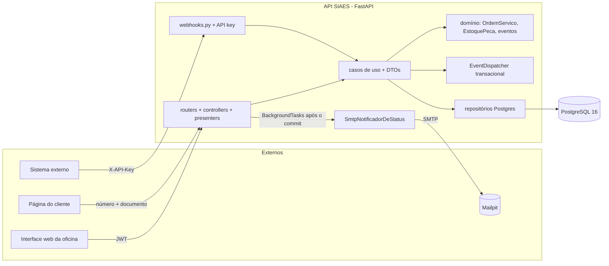
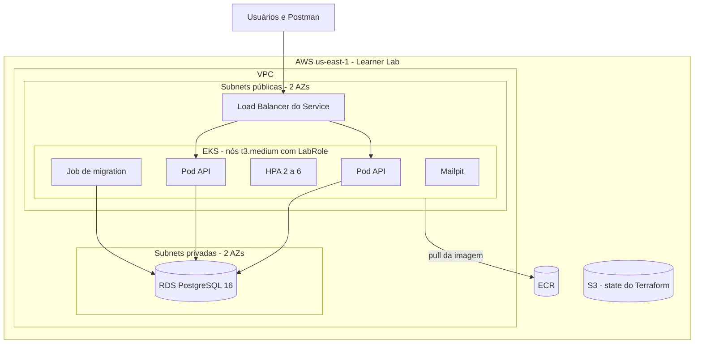
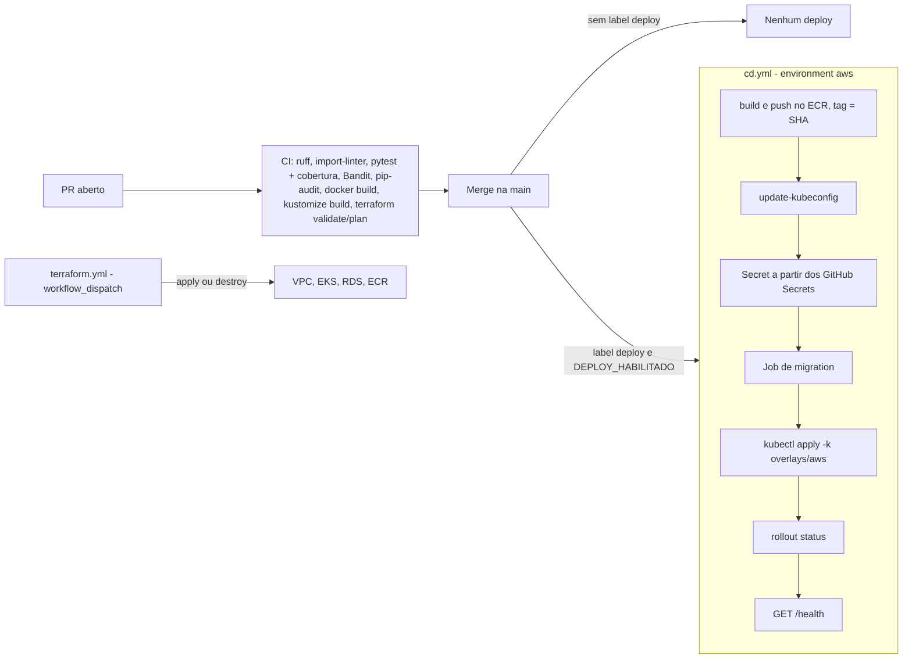

# Blueprint da Fase 2 – SIAES

> Versão 1.0, de 25/11/2026. Este documento substitui o [planejamento da Fase 2](PLANEJAMENTO-FASE-2.md) como referência de execução: as decisões em aberto do planejamento foram fechadas e registradas nos [ADRs](../adr/README.md). Ele serve de base para criar as issues da Fase 2; cada issue candidata da seção 6 vira uma issue no GitHub.

---

## Sumário

1. [Objetivo e escopo](#1-objetivo-e-escopo)
2. [Decisões](#2-decisões)
3. [Arquitetura-alvo](#3-arquitetura-alvo)
4. [Contratos de API](#4-contratos-de-api)
5. [Infraestrutura](#5-infraestrutura)
6. [Fases de execução e issues candidatas](#6-fases-de-execução-e-issues-candidatas)
7. [Divisão por trilha](#7-divisão-por-trilha)
8. [Riscos](#8-riscos)
9. [Checklist final de entrega](#9-checklist-final-de-entrega)

---

## 1. Objetivo e escopo

A oficina vai abrir novas unidades e precisa de alta disponibilidade, deploy automatizado e escalabilidade em horários de pico. A Fase 2 refatora o código da Fase 1 para a Clean Architecture, acrescenta as APIs pedidas pelo enunciado, empacota a aplicação para Kubernetes, provisiona a infraestrutura na AWS por Terraform e automatiza a entrega por GitHub Actions. O prazo de entrega é **19/01/2027**, no mesmo repositório da Fase 1.

### 1.1 Mapa do enunciado para os entregáveis

| # | Exigência do enunciado | Entregável | Requisito | Fase |
| :-- | :-- | :-- | :-- | :-- |
| 1 | Clean Code, Clean Architecture e testes nos fluxos críticos | DTOs de saída, controllers e presenters nos 54 casos de uso; import-linter no CI; suíte da Fase 1 e testes novos | RNF-01, RNF-12 a RNF-14 | 1 |
| 2 | Abertura de OS com cliente, veículo, serviços e peças, devolvendo a identificação | `POST /ordens-servico` com itens opcionais | RF-13, RF-17 | 2 |
| 3 | Consulta de status | `POST /acompanhamento` e `GET /ordens-servico/{id}`, com a tabela de correspondência dos status | RF-15, RF-25 | 2, 6 |
| 4 | Aprovação de orçamento por notificação externa | `POST /webhooks/orcamento` com API key e idempotência | RF-28 | 2 |
| 5 | Listagem ordenada por status, antigas primeiro, sem finalizadas e entregues | `GET /ordens-servico` priorizada, paginada e sem as encerradas | RF-14 | 2 |
| 6 | Atualização de status por e-mail | Notificação por e-mail após a transição, com Mailpit | RF-29 | 2 |
| 7 | Dockerfile e docker-compose | Migration separada, serviço `mailpit` | RNF-15 | 3 |
| 8 | Manifestos Kubernetes com HPA | `/k8s` com Kustomize, HPA por CPU e memória | RNF-17 | 3, 5 |
| 9 | Terraform do cluster e do banco | `/infra` com VPC, EKS, RDS e ECR | RNF-18 | 4 |
| 10 | CI/CD com build, testes, imagem, deploy do cluster, do banco e dos manifestos | `ci.yml`, `terraform.yml` e `cd.yml` | RNF-19 | 5 |
| — | README, desenho da arquitetura, collection, vídeo, PDF do portal | README da Fase 2, Mermaid, Postman, vídeo de até 15 min | — | 6, 7 |

### 1.2 Fora do escopo

- Entrada de decisões por resposta a e-mail ([ADR 0008](../adr/0008-notificacao-de-status-por-email.md)).
- Outbox e reenvio de e-mails ([ADR 0008](../adr/0008-notificacao-de-status-por-email.md)).
- Contador do rate limit compartilhado entre pods ([ADR 0012](../adr/0012-kubernetes-kustomize-e-hpa.md)).
- TLS e domínio próprio no ambiente AWS ([ADR 0009](../adr/0009-infraestrutura-aws-learner-lab.md)).
- As decisões em aberto da seção 8.2 do guia continuam em aberto e não bloqueiam a Fase 2.

---

## 2. Decisões

| ID | Tema | Decisão | ADR |
| :-- | :-- | :-- | :-- |
| G-1 | Repositório e integração | Mesmo repositório da Fase 1; PRs direto na `main` | [0011](../adr/0011-entrega-continua-por-label.md) |
| G-2 | Nuvem | AWS Academy Learner Lab, um lab único, região `us-east-1`; EKS, RDS PostgreSQL 16, ECR, subnets públicas sem NAT, Service `LoadBalancer` | [0009](../adr/0009-infraestrutura-aws-learner-lab.md) |
| G-3 | Abertura da OS | `POST /ordens-servico` com `servicos` e `pecas` opcionais, por id; OS nasce em `RECEBIDA` com os itens; itens editáveis em `RECEBIDA` e `EM_DIAGNOSTICO` | [0004](../adr/0004-abertura-da-os-com-itens.md) |
| G-4 | Prioridade e status | Ordem `EM_EXECUCAO`, `AGUARDANDO_EXECUCAO`, `AGUARDANDO_PECA`, `AGUARDANDO_APROVACAO`, `EM_DIAGNOSTICO`, `RECEBIDA`; a API mantém os 9 status, com tabela de correspondência; sem rota nova de status | [0005](../adr/0005-listagem-priorizada-e-paginada.md), [0006](../adr/0006-status-na-consulta.md) |
| G-5 | E-mail | Notificação de saída; o webhook cobre a entrada | [0008](../adr/0008-notificacao-de-status-por-email.md) |
| G-6 | Arquitetura | Clean Architecture leve; DTOs de saída e presenters em todos os 54 casos de uso; import-linter | [0002](../adr/0002-clean-architecture-leve.md), [0003](../adr/0003-verificacao-da-arquitetura-com-import-linter.md) |
| G-7 | Encerradas | `FINALIZADA`, `ENTREGUE` e `CANCELADA` fora da listagem sem filtro; visíveis com `status` explícito; paginação `limit`/`offset` | [0005](../adr/0005-listagem-priorizada-e-paginada.md) |
| G-8 | Momento do envio | Pós-commit com `BackgroundTasks`; falha só em log | [0008](../adr/0008-notificacao-de-status-por-email.md) |
| G-9 | Provedor de e-mail | Mailpit no compose e no cluster; na AWS, interface por `kubectl port-forward` | [0008](../adr/0008-notificacao-de-status-por-email.md) |
| G-10 | Calendário e divisão | Prazo 19/01/2027; ritmo reduzido de 22/12 a 04/01; congelamento em 08/01; trilhas sem responsáveis nominais | Este documento, seções 6 e 7 |
| — | Webhook | API key `X-API-Key`, só `numero_os`, tabela de notificações, origem `CLIENTE`, conflito `422` `NOTIFICACAO_DIVERGENTE` | [0007](../adr/0007-webhook-de-decisao-do-orcamento.md) |
| — | Terraform | State em S3 com lock nativo; `plan` em PR; `apply` e `destroy` manuais | [0010](../adr/0010-terraform-state-e-execucao.md) |
| — | CD | Label `deploy` em PR mesclado, `workflow_dispatch`, environment `aws`, `DEPLOY_HABILITADO` | [0011](../adr/0011-entrega-continua-por-label.md) |
| — | Kubernetes | Kustomize `base` e overlays `local` e `aws`; Docker Desktop no local; Job de migration; HPA CPU 60% e memória 80%, 2 a 6; rate limit por pod documentado | [0012](../adr/0012-kubernetes-kustomize-e-hpa.md) |
| — | Interface web | Atualização completa: quadro paginado e ordenado; abertura com itens na tela | Este documento, Fase 8 |
| — | Cobertura | 80% em `domain` e `application` (RNF-14), sem mudança | — |
| — | Collection | Postman com ambientes local e AWS em `docs/`, além do Swagger | Este documento, Fase 6 |
| — | Documentação | ADRs MADR em `docs/adr/`; RF e RNF alterados com observação e link | [0001](../adr/0001-registro-de-decisoes-em-adr.md) |

### 2.1 Premissas

Valores adotados sem decisão do grupo. Qualquer mudança gera um ADR.

- EKS com 2 nós `t3.medium` (máximo 3); RDS `db.t3.micro` single-AZ, sem acesso público.
- Adaptador SMTP com `smtplib` da biblioteca padrão, executado por `asyncio.to_thread`, como o `BcryptPasswordHasher`.
- Versões do Kubernetes do EKS, do Terraform (1.10 ou superior, para o `use_lockfile`) e do provider AWS fixadas na issue da Fase 4.
- Custo estimado com o ambiente ligado: ~US$ 0,23/h (~US$ 5,50/dia). O ambiente é destruído ao fim de cada sessão de trabalho.

---

## 3. Arquitetura-alvo

### 3.1 Estrutura de `src/` (Clean leve)

```text
src/
├── domain/                       Círculo 1 – Enterprise Business Rules
│   ├── entities/                 OrdemServico passa a aceitar itens em RECEBIDA (ADR 0004)
│   ├── value_objects/            + prioridade_status_os.py (ADR 0005)
│   ├── events/                   + status_os_alterado_event.py (ADR 0008)
│   └── repositories/             + notificacao_orcamento_repository.py (ADR 0007)
├── application/                  Círculo 2 – Application Business Rules
│   ├── dtos/                     NOVO: DTOs de entrada e saída, um arquivo por recurso (ADR 0002)
│   ├── use_cases/                54 casos de uso, todos devolvendo DTO; + decidir_orcamento_por_notificacao.py,
│   │                             + notificar_cliente_da_mudanca_de_status.py
│   ├── ports/                    + notificador_de_status.py (ADR 0008)
│   ├── events/                   EventDispatcher transacional (sem mudança)
│   └── handlers/                 sem mudança
├── infrastructure/               Círculos 3 (repositories/) e 4 (database/, security/, config.py)
│   ├── repositories/             + postgres_notificacao_orcamento_repository.py
│   ├── database/                 + notificacao_orcamento_model.py
│   ├── notificacoes/             NOVO: smtp_notificador_de_status.py
│   └── security/
└── presentation/                 Círculo 3 – Interface Adapters (entrada HTTP)
    ├── controllers/              NOVO: requisição → DTO de entrada, um arquivo por recurso
    ├── presenters/               NOVO: DTO de saída → schema de resposta, um arquivo por recurso
    ├── routers/                  finos; + webhooks.py
    ├── schemas/                  sem de_entidade; + webhook.py
    ├── middlewares/              + autenticação por API key do webhook (dependencies.py)
    ├── web/                      interface web (Fase 8)
    └── container.py              ponto de composição
```

### 3.2 Mapeamento das pastas para os círculos

| Círculo | Pastas | Regra |
| :-- | :-- | :-- |
| 1 – Enterprise Business Rules | `domain/` | Python puro; não importa nenhuma outra camada |
| 2 – Application Business Rules | `application/` | Importa só `domain`; recebe e devolve DTOs |
| 3 – Interface Adapters | `presentation/controllers`, `presentation/presenters`, `presentation/routers`, `presentation/schemas`, `infrastructure/repositories` | Converte entre o formato externo e os DTOs |
| 4 – Frameworks & Drivers | FastAPI, `infrastructure/database`, `infrastructure/security`, `infrastructure/notificacoes`, `infrastructure/config.py` | Detalhes técnicos |
| Composição | `presentation/container.py`, `migrations/env.py` | Únicos pontos que conhecem as implementações |

### 3.3 Componentes



### 3.4 Infraestrutura na AWS



### 3.5 Fluxo de entrega



---

## 4. Contratos de API

Todas as respostas de erro usam o corpo `ErroResponse` e os códigos da seção 5.5 do guia. Valores monetários trafegam como texto.

### 4.1 Abertura da OS com itens ([ADR 0004](../adr/0004-abertura-da-os-com-itens.md), RF-13, RF-17)

`POST /ordens-servico` – Atendente e Gerente.

```json
{
  "documento": "12345678909",
  "placa": "ABC1D23",
  "cliente": {"nome": "...", "email": "...", "telefone": "..."},
  "veiculo": {"marca": "...", "modelo": "...", "ano": 2020},
  "servicos": [{"servico_id": "uuid"}],
  "pecas": [{"peca_id": "uuid", "quantidade": 2}]
}
```

- `cliente`, `veiculo`, `servicos` e `pecas` são opcionais; o corpo da Fase 1 continua válido.
- `201`: a OS em `RECEBIDA`, com `id`, `numero`, `status` e os itens.
- `400`: documento, placa ou quantidade inválidos. `404`: cliente, veículo, serviço ou peça inexistentes. `422`: item excluído do catálogo, item repetido, veículo de outro cliente, corpo fora do DTO.
- Uma única unidade de trabalho; qualquer erro desfaz a abertura inteira.

### 4.2 Listagem priorizada ([ADR 0005](../adr/0005-listagem-priorizada-e-paginada.md), RF-14)

`GET /ordens-servico?documento=&placa=&status=&mecanico_id=&abertura_de=&abertura_ate=&limit=50&offset=0` – Atendente, Mecânico e Gerente.

```json
{
  "itens": [{"id": "uuid", "numero": "123-7F3A9C2B", "status": "EM_EXECUCAO", "cliente": "...", "placa": "...", "mecanico": "...", "data_abertura": "...", "total": "450.00"}],
  "total": 37,
  "limit": 50,
  "offset": 0
}
```

- Ordem: `EM_EXECUCAO`, `AGUARDANDO_EXECUCAO`, `AGUARDANDO_PECA`, `AGUARDANDO_APROVACAO`, `EM_DIAGNOSTICO`, `RECEBIDA`; depois `data_abertura` ascendente e `id`.
- Sem `status`, exclui `FINALIZADA`, `ENTREGUE` e `CANCELADA`.
- `limit` de 1 a 200 e `offset` a partir de 0; fora da faixa, `422` (`ENTRADA_INVALIDA`).

### 4.3 Consulta de status ([ADR 0006](../adr/0006-status-na-consulta.md))

Sem rota nova. `POST /acompanhamento` (cliente, sem JWT) e `GET /ordens-servico/{id}` (oficina) devolvem o status. A descrição das duas rotas no OpenAPI e o README trazem a tabela de correspondência:

| Status do enunciado | Status do sistema |
| :-- | :-- |
| Recebida | `RECEBIDA` |
| Diagnóstico | `EM_DIAGNOSTICO` |
| Aguardando Aprovação | `AGUARDANDO_APROVACAO` |
| Execução | `AGUARDANDO_PECA`, `AGUARDANDO_EXECUCAO`, `EM_EXECUCAO` |
| Finalizada | `FINALIZADA` |
| Entregue | `ENTREGUE` |
| (não citado) | `CANCELADA` |

### 4.4 Webhook de decisão do orçamento ([ADR 0007](../adr/0007-webhook-de-decisao-do-orcamento.md), RF-28)

`POST /webhooks/orcamento` – sem JWT, header `X-API-Key`.

```json
{"id_notificacao": "pagamento-9f2c", "numero_os": "123-7F3A9C2B", "decisao": "APROVADO"}
```

| Situação | Resposta |
| :-- | :-- |
| Chave ausente ou errada | `401` `NAO_AUTENTICADO` |
| Corpo fora do DTO (decisão desconhecida, id vazio ou com mais de 100 caracteres) | `422` `ENTRADA_INVALIDA` |
| Número inexistente ou malformado | `404` `ENTIDADE_NAO_ENCONTRADA` |
| OS fora de `AGUARDANDO_APROVACAO` | `422` `REGRA_DE_NEGOCIO_VIOLADA` |
| Primeira notificação válida | `200` com `{"numero_os", "status", "id_notificacao", "processada_em"}` |
| Reenvio idêntico | `200` com a resposta original, sem efeito novo |
| Mesmo `id_notificacao` com OS ou decisão diferentes | `422` `NOTIFICACAO_DIVERGENTE` |

- `APROVADO`: OS vai a `AGUARDANDO_EXECUCAO` ou `AGUARDANDO_PECA` (RF-26). `RECUSADO`: OS vai a `CANCELADA`, com o estorno das reservas na mesma transação (RF-18) e a repetição em impasse.
- Histórico com origem `CLIENTE`, sem usuário.
- Tabela `notificacoes_orcamento`: `id_notificacao` (chave única), `numero_os`, `decisao`, `recebida_em`, `status_resultante`.

### 4.5 Notificação por e-mail ([ADR 0008](../adr/0008-notificacao-de-status-por-email.md), RF-29)

| Status de destino | Conteúdo específico |
| :-- | :-- |
| `AGUARDANDO_APROVACAO` | Valor total do orçamento e o pedido de aprovação pelo link |
| `EM_EXECUCAO` | Início do serviço e a estimativa de entrega |
| `FINALIZADA` | Veículo pronto para retirada |
| `CANCELADA` | Motivo do cancelamento ou a rejeição do orçamento |

- Assunto: `SIAES - OS <numero>: <status em linguagem do cliente>`. Corpo em texto puro, com o link `URL_PUBLICA/cliente/#numero=<numero>`.
- O envio é agendado com `BackgroundTasks` depois da confirmação da transação; falha vai para o log com o número da OS e o status.
- Variáveis: `SMTP_HOST`, `SMTP_PORTA`, `SMTP_USUARIO`, `SMTP_SENHA`, `EMAIL_REMETENTE`, `URL_PUBLICA`.

---

## 5. Infraestrutura

### 5.1 Docker e Compose

| Item | Mudança |
| :-- | :-- |
| `Dockerfile` | `CMD` só com o Uvicorn; a migration passa a ser um comando separado (`alembic upgrade head`) usado pelo serviço `migration` e pelo Job |
| `docker-compose.yml` | Serviços `db`, `migration` (roda e termina), `app` (depende do `migration` concluído com sucesso) e `mailpit` (porta 8025 da interface e 1025 do SMTP) |
| `.env.example` | Variáveis novas: `WEBHOOK_API_KEY`, `SMTP_HOST`, `SMTP_PORTA`, `SMTP_USUARIO`, `SMTP_SENHA`, `EMAIL_REMETENTE`, `URL_PUBLICA` |
| `docker-compose.testes.yml` | Mantido |

### 5.2 Kubernetes (`/k8s`)

```text
k8s/
├── base/
│   ├── kustomization.yaml
│   ├── namespace.yaml              namespace siaes
│   ├── configmap.yaml              POSTGRES_HOST, POSTGRES_DB, SMTP_HOST, SMTP_PORTA, EMAIL_REMETENTE, URL_PUBLICA, RATE_LIMIT_PUBLICO, SEED_DEMO
│   ├── secret.example.yaml         só as chaves; o Secret real é criado fora do git
│   ├── deployment-api.yaml         2 réplicas, requests/limits, readiness e liveness em /health, usuário não-root
│   ├── service-api.yaml            ClusterIP na base
│   ├── hpa-api.yaml                autoscaling/v2, CPU 60%, memória 80%, 2 a 6
│   ├── job-migration.yaml          alembic upgrade head
│   └── mailpit.yaml                Deployment e Service do Mailpit
├── overlays/
│   ├── local/                      Docker Desktop: Postgres em StatefulSet com PVC, metrics-server com --kubelet-insecure-tls, imagem siaes:local, Service LoadBalancer em localhost
│   └── aws/                        imagem do ECR, POSTGRES_HOST do RDS, Service LoadBalancer
└── README.md                       pré-requisitos, criação do Secret a partir do .env, apply, teste do HPA com o Locust
```

### 5.3 Terraform (`/infra`)

```text
infra/
├── bootstrap/                      state local; cria o bucket S3 do state (versionado, sem acesso público)
├── main.tf, versions.tf, backend.tf (S3 + use_lockfile), variables.tf, outputs.tf
├── vpc.tf                          VPC, 2 subnets públicas, 2 privadas, internet gateway, sem NAT
├── eks.tf                          cluster e node group com a LabRole, addon metrics-server
├── rds.tf                          PostgreSQL 16 db.t3.micro, subnet group privado, security group só dos nós
├── ecr.tf                          repositório da imagem
└── README.md                       recursos, variáveis, comandos, custo por hora, destroy ao fim da sessão
```

Outputs: nome do cluster, endpoint do RDS, URL do ECR.

### 5.4 Pipelines

| Workflow | Gatilho | Passos |
| :-- | :-- | :-- |
| `ci.yml` (existente) | PR e push na `main` | `uv sync --frozen`, `ruff check`, `ruff format --check`, `lint-imports`, `pytest` com cobertura ≥ 80%, Bandit, pip-audit, `docker build`, `kubectl kustomize` dos dois overlays |
| `terraform.yml` (novo) | PR que altera `infra/`; `workflow_dispatch` com a ação `apply` ou `destroy` | `fmt -check`, `validate`, `plan` (com o environment `aws` habilitado); `apply` ou `destroy` só no dispatch |
| `cd.yml` (novo) | `pull_request` `closed` na `main`, mesclado e com a label `deploy`; `workflow_dispatch` | Verifica `DEPLOY_HABILITADO`; build e push no ECR (tag = SHA); `update-kubeconfig`; Secret; Job de migration; `kubectl apply -k k8s/overlays/aws`; `rollout status`; `GET /health` |

### 5.5 Segredos e variáveis

| Nome | Onde fica | Usado por |
| :-- | :-- | :-- |
| `AWS_ACCESS_KEY_ID`, `AWS_SECRET_ACCESS_KEY`, `AWS_SESSION_TOKEN` | Environment `aws` (atualizados a cada sessão do lab) | `terraform.yml`, `cd.yml` |
| `JWT_SECRET_KEY`, `ADMIN_PASSWORD`, `POSTGRES_PASSWORD`, `WEBHOOK_API_KEY` | Environment `aws`; `.env` no local | Secret do Kubernetes, variável sensível do Terraform (senha do RDS) |
| `DEPLOY_HABILITADO` | Variável do environment `aws` | `cd.yml`, `terraform.yml` (plan) |
| Variáveis não sensíveis | `k8s/base/configmap.yaml` e patches dos overlays | Pods |

---

## 6. Fases de execução e issues candidatas

As fases 0 a 7 são as da Parte H do planejamento, com as datas refeitas a partir de 25/11/2026. A Fase 8 é nova: a interface web completa foi decidida depois do planejamento e depende dos contratos da Fase 2, por isso fica fora dela para não atrasar o marco das APIs. O período de 22/12 a 04/01 tem ritmo reduzido e recebe só documentação e interface.

### 6.1 Calendário

| Fase | Janela | Depende de | Marco |
| :-- | :-- | :-- | :-- |
| 0 – Alinhamento | 25/11 a 28/11 | — | Blueprint, ADRs e requisitos na `main`; issues criadas; lab preparado |
| 1 – Linha de base e arquitetura | 30/11 a 11/12 | 0 | Suíte verde, import-linter no CI, nenhum `de_entidade` nos routers |
| 2 – APIs | 07/12 a 21/12 | F1-01 | Todos os endpoints do enunciado com testes |
| 3 – Docker e K8s local | 30/11 a 14/12 | 0 | `kubectl apply -k k8s/overlays/local` sobe tudo e o HPA escala com o Locust |
| 4 – Terraform | 07/12 a 21/12 | F0-04 | Ambiente criado do zero e destruído pelo Terraform |
| 5 – CI/CD | 14/12 a 21/12 e 05/01 a 08/01 | 3, 4 | PR mesclado com a label `deploy` implanta no EKS sem passo manual |
| 8 – Interface web | 14/12 a 04/01 | F2-02, F2-03 | Telas usam os contratos novos sem regressão |
| 6 – Documentação e evidências | 22/12 a 12/01 | 2, 5 | README, desenho, collection e evidências completos |
| **Congelamento de código** | **08/01** | — | Só correções a partir daqui |
| 7 – Vídeo e entrega | 11/01 a 16/01; buffer 18 e 19/01 | 6 | Entrega submetida no portal |

A tabela segue a ordem do calendário; a numeração das fases segue a Parte H.

### 6.2 Formato das issues candidatas

Cada issue traz: **ID** (fase e sequência), **título** no formato de commit, **requisito** (RF, RNF ou ADR), **arquivos**, **critério de aceite** verificável, **dependências** e **esforço** (P até 1 dia, M de 2 a 3 dias, G de 4 a 5 dias). Ao criar a issue, siga o `AGENTS.md`: atribuição a quem implementa e `Closes #<número>` no PR.

---

### Fase 0 – Alinhamento (25/11 a 28/11)

**Meta:** decisões registradas em ADR, issues criadas, repositório compartilhado e Learner Lab pronto.

| ID | Título | Requisito | Arquivos | Critério de aceite | Dependências | Esforço |
| :-- | :-- | :-- | :-- | :-- | :-- | :-- |
| F0-01 | `docs: blueprint, ADRs e requisitos da fase 2` | ADR 0001 a 0012 | `docs/fase2/`, `docs/adr/`, `docs/requisitos-*.md`, `AGENTS.md`, guia | PR aprovado e mesclado; links válidos | — | P |
| F0-02 | `chore: cria as issues da fase 2` | — | GitHub | Uma issue por linha das seções 6.3 a 6.11, com fase, requisito e critério de aceite | F0-01 | P |
| F0-03 | `chore: compartilha o repositório e protege a main` | Enunciado | GitHub | Usuário `soat-architecture` com acesso de leitura; `main` com PR obrigatório, 1 aprovação e o check "Lint, testes e segurança" obrigatório; label `deploy` criada | — | P |
| F0-04 | `chore: prepara o Learner Lab e o environment aws` | ADR 0009, 0010 | GitHub (environment `aws`) | Lab iniciado; environment `aws` com as 3 credenciais, os 4 segredos da aplicação e `DEPLOY_HABILITADO=false`; procedimento de renovação das credenciais escrito na issue | — | P |

---

### Fase 1 – Linha de base e arquitetura (30/11 a 11/12)

**Meta:** suíte da Fase 1 verde, contratos do import-linter passando no CI e nenhum caso de uso devolvendo entidade.

| ID | Título | Requisito | Arquivos | Critério de aceite | Dependências | Esforço |
| :-- | :-- | :-- | :-- | :-- | :-- | :-- |
| F1-01 | `build: verifica a regra de dependência com import-linter` | RNF-01, ADR 0003 | `pyproject.toml`, `uv.lock`, `.github/workflows/ci.yml`, guia §8.1 | `uv run lint-imports` passa com os 4 contratos; um import proibido de teste faz o job falhar; linha nova na §8.1 com link para o ADR | F0-01 | P |
| F1-02 | `refactor: cria a estrutura de DTOs, controllers e presenters` | RNF-01, ADR 0002 | `application/dtos/`, `presentation/controllers/`, `presentation/presenters/` (com `__init__.py`), guia §2, §3 e §5.4, `docs/estrutura-de-pastas.md`, `docs/ddd/c4-model.md` | Pastas criadas; receita da §5.4 devolvendo DTO; `DetalheDaOrdemServico`, `ResumoDaOrdemServico` e `CriteriosDaListagem` movidos para `application/dtos/ordem_servico.py`; suíte verde | F0-01 | M |
| F1-03 | `refactor: DTOs de saída nos casos de uso de usuários e autenticação` | ADR 0002, RF-01, RF-03 | `application/dtos/usuario.py`, use cases de usuário e `autenticar_usuario.py`, `routers/usuarios.py`, `routers/autenticacao.py`, presenters e controllers | Nenhum `de_entidade` nos dois routers; casos de uso devolvem DTO; testes de rota e unitários verdes | F1-02 | M |
| F1-04 | `refactor: DTOs de saída nos casos de uso de clientes` | ADR 0002, RF-04 a RF-06 | `application/dtos/cliente.py`, use cases de cliente, `routers/clientes.py` | Idem F1-03 para clientes | F1-02 | P |
| F1-05 | `refactor: DTOs de saída nos casos de uso de veículos` | ADR 0002, RF-07 a RF-09 | `application/dtos/veiculo.py`, use cases de veículo, `routers/veiculos.py` | Idem para veículos | F1-02 | P |
| F1-06 | `refactor: DTOs de saída nos casos de uso de serviços` | ADR 0002, RF-10, RF-11 | `application/dtos/servico.py`, use cases de serviço, `routers/servicos.py` | Idem para serviços | F1-02 | P |
| F1-07 | `refactor: DTOs de saída nos casos de uso de peças` | ADR 0002, RF-12 | `application/dtos/peca.py`, use cases de peça, `routers/pecas.py` | Idem para peças, com as quantidades e o saldo no DTO | F1-02 | M |
| F1-08 | `refactor: DTOs de saída na abertura, listagem e detalhamento da OS` | ADR 0002, RF-13 a RF-15 | `application/dtos/ordem_servico.py`, `criar_os.py`, `listar_ordens_servico.py`, `detalhar_ordem_servico.py`, `routers/ordens_servico.py` | Os 3 casos de uso devolvem DTO; rotas correspondentes sem `de_entidade` | F1-02 | M |
| F1-09 | `refactor: DTOs de saída nas transições e nos itens da OS` | ADR 0002, RF-16 a RF-23, RF-26 | use cases de itens, orçamento, execução, conclusão, entrega, cancelamento e decisão no balcão; `routers/ordens_servico.py` | Nenhum `de_entidade` restante em `routers/ordens_servico.py`; testes verdes | F1-08 | G |
| F1-10 | `refactor: DTOs de saída no acompanhamento público e nos relatórios` | ADR 0002, RF-25 a RF-27 | `consultar_os_publica.py`, `aprovar_orcamento.py`, `rejeitar_orcamento.py`, `gerar_relatorio_de_tempos.py`, `routers/acompanhamento_publico.py`, `routers/relatorios.py` | Nenhum `de_entidade` em `presentation/`; `grep -rn "de_entidade" src/presentation` vazio; cobertura ≥ 80% | F1-02 | M |

---

### Fase 2 – APIs (07/12 a 21/12, em paralelo com a Fase 3)

**Meta:** todos os endpoints do enunciado funcionando, no molde da Fase 1, com testes unitários e de integração.

| ID | Título | Requisito | Arquivos | Critério de aceite | Dependências | Esforço |
| :-- | :-- | :-- | :-- | :-- | :-- | :-- |
| F2-01 | `feat: permite editar os itens da OS em RECEBIDA` | RF-17, ADR 0004 | `domain/entities/ordem_servico.py`, `docs/ddd/linguagem-ubiqua.md`, testes unitários | Incluir e remover itens funciona em `RECEBIDA` e `EM_DIAGNOSTICO` e responde `ItensBloqueados` nos demais status; teste para cada status | F1-02 | P |
| F2-02 | `feat: abre a OS com serviços e peças` | RF-13, ADR 0004 | `criar_os.py`, `application/dtos/ordem_servico.py`, `schemas/ordem_servico.py`, controller, router, guia §8.1 "Abertura da OS" | Corpo com itens cria a OS em `RECEBIDA` com os itens; corpo da Fase 1 continua válido; item inexistente `404`, excluído ou repetido `422`, quantidade `0` `400`; falha em qualquer item não grava nada (teste de integração conferindo o banco) | F2-01, F1-08 | M |
| F2-03 | `feat: lista as OS por prioridade de status com paginação` | RF-14, ADR 0005 | `domain/value_objects/prioridade_status_os.py`, `domain/repositories/ordem_servico_repository.py`, `postgres_ordem_servico_repository.py`, `listar_ordens_servico.py`, schema, router, guia §8.1 "Listagem de OS" | Ordem da ADR 0005 com desempate por data e id; encerradas excluídas sem `status` e listadas com `status`; `limit` e `offset` com `total`; `limit=0` ou `201` respondem `422`; testes de integração com OS em todos os 9 status | F1-08 | M |
| F2-04 | `docs: documenta a correspondência dos status na consulta` | RF-15, RF-25, ADR 0006 | descrições do OpenAPI em `routers/acompanhamento_publico.py` e `routers/ordens_servico.py`, `tests/unit/test_openapi.py` | A descrição das duas rotas traz a tabela da seção 4.3; teste do OpenAPI verifica a presença | F1-10 | P |
| F2-05 | `feat: registra as notificações de decisão do orçamento` | RF-28, ADR 0007 | `domain/entities/notificacao_orcamento.py`, `domain/repositories/notificacao_orcamento_repository.py`, `infrastructure/database/notificacao_orcamento_model.py`, `postgres_notificacao_orcamento_repository.py`, `migrations/versions/0008_...`, `migrations/env.py`, `tests/unit/conftest.py` | Migration cria a tabela com `id_notificacao` único; repositório em memória na fixture; teste de integração de gravação e leitura; teste de migration verde | F1-02 | M |
| F2-06 | `feat: recebe a decisão do orçamento por webhook` | RF-28, ADR 0007 | `application/use_cases/decidir_orcamento_por_notificacao.py`, `application/dtos/`, `presentation/routers/webhooks.py`, `schemas/webhook.py`, `middlewares/dependencies.py` (API key), `middlewares/tratamento_de_erros.py` (`NOTIFICACAO_DIVERGENTE`), `container.py`, `infrastructure/config.py`, `.env.example`, guia §5.5, §5.6 e §8.1 | Todos os casos da tabela da seção 4.4 cobertos por teste de integração; comparação da chave em tempo constante; subida falha sem `WEBHOOK_API_KEY`; recusa com estorno e repetição em impasse; rota no OpenAPI com o esquema da API key | F2-05 | G |
| F2-07 | `feat: emite o evento de mudança de status para notificação` | RF-29, ADR 0008 | `domain/events/status_os_alterado_event.py`, `domain/entities/ordem_servico.py`, `docs/ddd/linguagem-ubiqua.md` | `_mudar_status` acumula o evento só para os 4 status de destino; o evento não chega ao `EventDispatcher` transacional; teste para cada transição | F1-02 | P |
| F2-08 | `feat: envia o e-mail de mudança de status ao cliente` | RF-29, ADR 0008 | `application/ports/notificador_de_status.py`, `application/use_cases/notificar_cliente_da_mudanca_de_status.py`, `infrastructure/notificacoes/smtp_notificador_de_status.py`, `config.py`, `container.py`, routers das transições (agendamento com `BackgroundTasks`), guia §2.2, §3 e §8.1 | E-mail enviado após o commit nas transições dos 4 status; transição desfeita não envia; falha do SMTP não altera a resposta e gera log; corpo em texto puro sem documento; teste unitário com notificador falso; teste de integração com servidor SMTP de teste | F2-07 | G |
| F2-09 | `test: cobre os fluxos críticos da fase 2 de ponta a ponta` | RNF-13 | `tests/integration/test_fluxo_fase_2.py` | Fluxo abrir com itens → atribuir → concluir orçamento → webhook aprova → listagem mostra a OS na posição certa → e-mail registrado pelo notificador de teste | F2-02, F2-03, F2-06, F2-08 | M |

A F2-08 depende só da F2-07 para os testes automatizados; o Mailpit do compose (F3-02) é usado na verificação manual.

---

### Fase 3 – Docker e K8s local (30/11 a 14/12, em paralelo com a Fase 2)

**Meta:** `kubectl apply -k k8s/overlays/local` sobe a aplicação no Kubernetes do Docker Desktop e o HPA escala sob carga do Locust.

| ID | Título | Requisito | Arquivos | Critério de aceite | Dependências | Esforço |
| :-- | :-- | :-- | :-- | :-- | :-- | :-- |
| F3-01 | `build: separa a migration da subida da API` | RNF-15, ADR 0012 | `Dockerfile`, `docker-compose.yml`, guia §8.1 "Migrations" | `CMD` só com o Uvicorn; serviço `migration` roda e termina; `app` sobe só depois dele; `docker compose up --build` funciona do zero | F0-01 | P |
| F3-02 | `build: acrescenta o Mailpit e as variáveis da fase 2 ao compose` | RNF-15, ADR 0008 | `docker-compose.yml`, `.env.example` | Interface do Mailpit em `localhost:8025`; `.env.example` com as variáveis da seção 5.1, sem valores reais | F3-01 | P |
| F3-03 | `build: cria a base dos manifestos Kubernetes` | RNF-17, ADR 0012 | `k8s/base/*` | `kubectl kustomize k8s/base` gera Namespace, ConfigMap, Deployment, Service, HPA, Job e Mailpit válidos; Deployment com 2 réplicas, requests/limits e probes em `/health` | F3-01 | M |
| F3-04 | `build: cria o overlay local para o Docker Desktop` | RNF-17, ADR 0012 | `k8s/overlays/local/*`, `k8s/README.md` | Postgres em StatefulSet com PVC; metrics-server funcionando (`kubectl top pods`); Secret criado a partir do `.env` pelo comando documentado; API responde em `localhost` | F3-03 | M |
| F3-05 | `test: valida a escala do HPA com o Locust no cluster local` | RNF-17, RNF-10 | `tests/desempenho/`, `k8s/README.md`, `docs/evidencias/` | Com o Locust apontado para o cluster, `kubectl get hpa -w` mostra a subida de 2 para mais réplicas e a descida após a carga; evidência registrada | F3-04 | M |

---

### Fase 4 – Terraform (07/12 a 21/12)

**Meta:** ambiente AWS criado do zero e destruído por completo pelo Terraform, com o state no S3.

| ID | Título | Requisito | Arquivos | Critério de aceite | Dependências | Esforço |
| :-- | :-- | :-- | :-- | :-- | :-- | :-- |
| F4-01 | `build: cria o bootstrap do state do Terraform` | RNF-18, ADR 0010 | `infra/bootstrap/`, `.gitignore` | `terraform apply` cria o bucket versionado e privado; `*.tfstate`, `*.tfvars` e `.terraform/` ignorados | F0-04 | P |
| F4-02 | `build: provisiona a VPC` | RNF-18, ADR 0009 | `infra/versions.tf`, `backend.tf`, `variables.tf`, `vpc.tf` | 2 subnets públicas e 2 privadas em 2 AZs, sem NAT; `plan` limpo após o `apply` | F4-01 | M |
| F4-03 | `build: provisiona o cluster EKS com a LabRole` | RNF-17, RNF-18, ADR 0009 | `infra/eks.tf`, `outputs.tf` | Cluster e node group criados com a `LabRole`; `kubectl get nodes` lista 2 nós; `kubectl top nodes` funciona (metrics-server) | F4-02 | G |
| F4-04 | `build: provisiona o RDS e o ECR` | RNF-09, RNF-18, ADR 0009 | `infra/rds.tf`, `infra/ecr.tf`, `outputs.tf` | RDS PostgreSQL 16 sem acesso público, alcançável só pelos nós; repositório ECR criado; senha do RDS por variável sensível | F4-02 | M |
| F4-05 | `docs: documenta a infraestrutura e o procedimento de destroy` | RNF-18 | `infra/README.md` | Lista de recursos, variáveis, comandos, custo por hora e roteiro de destroy; um integrante que não escreveu o código cria e destrói o ambiente seguindo só o README | F4-03, F4-04 | P |

---

### Fase 5 – CI/CD (14/12 a 21/12 e 05/01 a 08/01)

**Meta:** um PR mesclado com a label `deploy` implanta a versão no EKS sem passo manual, com o lab ligado.

| ID | Título | Requisito | Arquivos | Critério de aceite | Dependências | Esforço |
| :-- | :-- | :-- | :-- | :-- | :-- | :-- |
| F5-01 | `ci: valida os manifestos Kubernetes no CI` | RNF-19 | `.github/workflows/ci.yml` | `kubectl kustomize` dos overlays `local` e `aws` roda em todo PR e falha com YAML inválido | F3-03 | P |
| F5-02 | `ci: valida e planeja o Terraform nos PRs` | RNF-18, RNF-19, ADR 0010 | `.github/workflows/terraform.yml` | `fmt -check` e `validate` em todo PR que altera `infra/`; `plan` com `DEPLOY_HABILITADO=true`; `apply` e `destroy` só por `workflow_dispatch` | F4-02 | M |
| F5-03 | `build: cria o overlay aws` | RNF-17, ADR 0012 | `k8s/overlays/aws/*` | Imagem do ECR por patch; `POSTGRES_HOST` do output do RDS; Service `LoadBalancer`; Mailpit acessível por `kubectl port-forward` | F3-03, F4-04 | P |
| F5-04 | `ci: implanta no EKS pela label deploy` | RNF-19, ADR 0011 | `.github/workflows/cd.yml`, guia §7 e §8.1 | PR mesclado com a label executa os passos da seção 5.4 até o `/health` responder `200`; sem a label o workflow não executa; com `DEPLOY_HABILITADO=false` o job termina com o motivo no resumo; `workflow_dispatch` reimplanta | F5-03, F4-03 | G |
| F5-05 | `test: executa o primeiro deploy completo na AWS` | RNF-17 a RNF-19 | `docs/evidencias/` | Ambiente criado pelo `terraform.yml`, deploy pelo `cd.yml`, chamadas da collection respondendo pelo endereço do Service, HPA escalando com o Locust, `destroy` ao final; evidências (prints e links das execuções) registradas | F5-04, F2-09 | M |

---

### Fase 6 – Documentação e evidências (22/12 a 12/01)

**Meta:** README da Fase 2, desenho da arquitetura, collection e evidências completos.

| ID | Título | Requisito | Arquivos | Critério de aceite | Dependências | Esforço |
| :-- | :-- | :-- | :-- | :-- | :-- | :-- |
| F6-01 | `docs: reescreve o README para a fase 2` | Enunciado, RNF-16 | `README.md` | Objetivos da fase; desenho (componentes, infraestrutura, fluxo de deploy); execução local, K8s e Terraform; tabela de correspondência dos status; limitações (rate limit por pod, sem TLS); links da collection, do Swagger e do vídeo | F5-05 | M |
| F6-02 | `docs: exporta o desenho da arquitetura` | Enunciado | `docs/fase2/arquitetura.png` (ou `.pdf`), `docs/ddd/c4-model.md` | Imagem com os recursos AWS escolhidos, pronta para o PDF do portal; C4 nível 2 e 3 atualizados | F6-01 | P |
| F6-03 | `docs: cria a collection Postman da fase 2` | Enunciado | `docs/postman/siaes-fase-2.postman_collection.json`, ambientes `local` e `aws` | Requisições na ordem do vídeo (login, abrir OS com itens, listar, concluir orçamento, webhook, consulta pública); variáveis para a URL, o token e a API key, sem valores reais | F2-09 | M |
| F6-04 | `docs: atualiza as evidências de cobertura, desempenho e escala` | RNF-10, RNF-14, RNF-17 | `docs/evidencias/` | Cobertura do commit atual; desempenho repetido; evidência do HPA local e na AWS; links das execuções do CI e do CD | F5-05 | P |
| F6-05 | `docs: repete a análise de segurança no commit final` | RNF-06, RNF-07 | `docs/security/` | Bandit, pip-audit e Trivy sobre o commit congelado; revisão de segredos; nenhum achado crítico aberto | Congelamento | P |
| F6-06 | `docs: atualiza o roadmap e o estado da fase 2` | — | `docs/fase2/` | Checklist da seção 9 deste documento marcado com o estado real | F6-01 | P |

---

### Fase 7 – Vídeo e entrega (11/01 a 16/01; buffer 18 e 19/01)

**Meta:** vídeo publicado, PDF do portal montado e entrega submetida.

| ID | Título | Requisito | Arquivos | Critério de aceite | Dependências | Esforço |
| :-- | :-- | :-- | :-- | :-- | :-- | :-- |
| F7-01 | `docs: escreve o roteiro cronometrado do vídeo` | Enunciado | `docs/fase2/roteiro-do-video.md` | Roteiro de até 15 min: arquitetura (2 min), `terraform apply` e cluster no ar, PR com label disparando o CD, chamadas da collection, e-mail no Mailpit, Locust com `kubectl get hpa -w`; ensaio cronometrado registrado | F6-01 | P |
| F7-02 | `docs: grava e publica o vídeo` | Enunciado | `README.md` (link) | Vídeo de até 15 min no YouTube ou Vimeo, público ou não listado; link no README; ambiente destruído após a gravação | F7-01 | M |
| F7-03 | `docs: monta o PDF do portal` | Enunciado | fora do repositório | PDF com o link do repositório, o desenho da arquitetura e o link do vídeo; acesso do `soat-architecture` conferido; submissão até 19/01 | F7-02, F6-02 | P |

---

### Fase 8 – Interface web (14/12 a 04/01, nova)

**Meta:** as telas da Frente da Loja usam os contratos novos sem regressão, com verificação pelo roteiro manual.

| ID | Título | Requisito | Arquivos | Critério de aceite | Dependências | Esforço |
| :-- | :-- | :-- | :-- | :-- | :-- | :-- |
| F8-01 | `feat: adapta o quadro de OS à listagem priorizada e paginada` | RF-14, ADR 0005 | `presentation/web/oficina/` | O quadro lê `itens` e `total`, mostra a ordem por prioridade, navega entre páginas e filtra encerradas por status; versão de celular continua em lista; roteiro manual atualizado e executado | F2-03 | M |
| F8-02 | `feat: abre a OS com serviços e peças pela interface` | RF-13, ADR 0004 | `presentation/web/oficina/` | O formulário de abertura busca serviços e peças ativos e envia os itens; erros de item aparecem por `textContent`; roteiro manual executado | F2-02 | M |
| F8-03 | `test: atualiza o roteiro manual da interface web` | RNF-13 | roteiro da interface web, `tests/integration/` (entrega das páginas) | Roteiro cobre listagem paginada, abertura com itens e o link do e-mail abrindo a página do cliente; testes de entrega das páginas e dos cabeçalhos continuam verdes | F8-01, F8-02 | P |

---

## 7. Divisão por trilha

Sem responsáveis nominais; o grupo distribui as issues ao criá-las.

| Trilha | Conteúdo | Fases |
| :-- | :-- | :-- |
| Aplicação | Refatoração, APIs, e-mail, testes e interface web | 1, 2, 8 |
| Plataforma | Docker, Kubernetes e HPA | 3 |
| Nuvem/IaC | Terraform e CD | 4, 5 |
| Documentação/entrega | README, desenho, collection, evidências, vídeo e PDF (todos colaboram) | 6, 7 |

---

## 8. Riscos

| Risco | Impacto | Mitigação |
| :-- | :-- | :-- |
| Sessão do Learner Lab expira (~4 h) durante um deploy ou a gravação | CD falha; gravação interrompida | Renovar as credenciais antes de cada sessão; `DEPLOY_HABILITADO`; gravar logo após iniciar o lab |
| Crédito do Learner Lab acaba (~US$ 5,50/dia ligado) | Sem ambiente AWS para o vídeo | `destroy` ao fim de cada sessão; overlay local como plano B para a demonstração |
| `LabRole` não atende algum recurso do EKS | Terraform do cluster bloqueado | Testar o EKS na primeira semana da Fase 4 (F4-03); alternativa registrada no ADR 0009 (k3s em EC2) exige ADR novo |
| HPA não escala (sem metrics-server ou sem `requests`) | Perde o item mais visual do vídeo | F3-05 valida no local antes da AWS |
| Migration concorrente com várias réplicas | Falha de deploy | Job único antes do rollout (ADR 0012) |
| Mudança do RF-14 e do RF-17 quebra testes da Fase 1 | Regressão | Requisito e testes alterados no mesmo PR (F2-01, F2-03) |
| Migração dos DTOs conflita com as APIs novas | Retrabalho | F1-02 e F1-08 antes de F2-02 e F2-03; os PRs de DTO são por router |
| E-mail perdido em queda do pod | Cliente sem aviso | Aceito no ADR 0008; registrado no README |
| Segredo vazando no git ou no log do CI | Incidente e perda de nota | GitHub Secrets, `secret.example.yaml`, revisão de segredos (F6-05) |
| API key do webhook trafegando sem TLS na AWS | Exposição da chave | Limitação registrada (ADR 0009); chave trocada após o vídeo |
| Vídeo acima de 15 min | Descumprimento | Roteiro cronometrado e ensaio (F7-01) |
| Ritmo reduzido nas festas atrasa o CD | Vídeo sem deploy real | CD dividido em duas janelas e congelamento em 08/01 |

---

## 9. Checklist final de entrega

**Código e arquitetura**
- [ ] Clean Architecture leve aplicada; nenhum caso de uso devolvendo entidade; import-linter passando
- [ ] Suíte da Fase 1 e testes novos verdes; cobertura ≥ 80% em `domain` e `application`

**APIs**
- [ ] Abertura de OS com cliente, veículo, serviços e peças devolvendo `id` e `numero`
- [ ] Consulta de status documentada com a correspondência dos status
- [ ] Webhook de aprovação e recusa autenticado e idempotente
- [ ] Listagem por prioridade, antigas primeiro, sem encerradas, paginada
- [ ] E-mail de mudança de status visível no Mailpit
- [ ] Interface web com a listagem nova e a abertura com itens

**Infraestrutura**
- [ ] Dockerfile e docker-compose com migration separada e Mailpit
- [ ] `/k8s` com Deployments, Services, ConfigMaps, Secrets (modelo), HPA e Job de migration
- [ ] `/infra` com VPC, EKS, RDS e ECR e o `infra/README.md`
- [ ] Pipelines: CI, Terraform e CD com deploy do banco e dos manifestos

**Documentação e portal**
- [ ] README com solução, desenho (componentes, infraestrutura e fluxo de deploy) e instruções local, K8s e Terraform
- [ ] Collection Postman e link do Swagger
- [ ] Vídeo de até 15 min publicado e linkado
- [ ] Repositório compartilhado com `soat-architecture`
- [ ] PDF do portal com o link do repositório, o desenho e o link do vídeo
- [ ] Ambiente AWS destruído após a gravação
