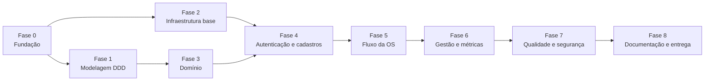

# Roadmap de Desenvolvimento - MVP SIAES

Este documento organiza o desenvolvimento do MVP do **Sistema Integrado de Atendimento e Execução de Serviços (SIAES)** em fases, da fundação do projeto até a entrega final do Tech Challenge da Fase 1. Cada tarefa referencia os requisitos de [requisitos-funcionais.md](docs/requisitos-funcionais.md) (RF) e [requisitos-nao-funcionais.md](docs/requisitos-nao-funcionais.md) (RNF), o [modelo C4](docs/ddd/c4-model.md) e os itens exigidos pelo enunciado. Para saber onde e como implementar cada tarefa, siga o [guia de desenvolvimento](docs/guia-de-desenvolvimento.md).

**Como usar:** marque a tarefa como concluída (`[x]`) no mesmo Pull Request que a entrega. A ordem das fases segue as dependências técnicas; fases sem dependência entre si podem andar em paralelo.

---

## Estado Atual

> Atualizado em 16/10/2026, considerando a `main` até o merge do PR #48 e a branch `docs/event-storming-pecas`.

| Item | Situação |
| :--- | :--- |
| Requisitos funcionais e não funcionais | Revisados no fechamento da Fase 0 (RF-01 a RF-27, RNF-01 a RNF-16), com peça pendente, fila de execução, histórico de status, listagem e detalhamento de OS e os RNFs exigidos pelo enunciado restaurados |
| Linguagem ubíqua | Atualizada com os 9 status, a tabela de transições e os termos de estoque; os nomes ainda divergem do modelo C4 em alguns pontos (Fase 1) |
| Modelo C4 | Documentado nos 4 níveis; camada de entrada renomeada para `src/presentation/`; estrutura de pastas da seção 6 aprovada pelo grupo (issue #9) |
| Guia de desenvolvimento e estrutura de pastas | Atualizados para a numeração atual dos requisitos, com as decisões técnicas da seção 8 |
| Event Storming | PDF reexportado com os fluxos de peça pendente e de cancelamento; link do board registrado em [docs/ddd/event-storming.md](docs/ddd/event-storming.md) |
| Código (`src/`) e testes | Rota `GET /health` em `src/presentation/api/main.py`. Os demais arquivos das camadas e da autenticação JWT continuam vazios; nenhum teste |
| Configuração do repositório | `.gitignore`, `.env.example` e `pyproject.toml` criados; falta gerar o `uv.lock` |
| Docker | Primeira versão de `Dockerfile` e `docker-compose.yml` (só o serviço `api`); diverge do RNF-15 (ver Fase 2) |
| README | Apenas título |

---

## Visão Geral das Fases

| Fase | Objetivo | Depende de | Resultado esperado | Situação |
| :--- | :--- | :--- | :--- | :--- |
| **0** | Fundação | - | Decisões fechadas, documentos alinhados entre si e ao enunciado, repositório configurado | Em andamento |
| **1** | Modelagem DDD | 0 | Event Storming completo e legível, diagramas e linguagem ubíqua consistentes entre si | Em andamento |
| **2** | Infraestrutura base | 0 | `docker compose up --build` sobe API + PostgreSQL com Swagger em `/docs` | Em andamento (health check e Docker inicial) |
| **3** | Domínio | 1 | Entidades, objetos de valor, eventos e regras de negócio com testes unitários | Não iniciada |
| **4** | Autenticação e cadastros | 2, 3 | Login JWT, RBAC, gestão de usuários e cadastros administrativos | Não iniciada (arquivos criados, vazios) |
| **5** | Fluxo da OS | 4 | Abertura, orçamento, reserva e pendência de peças, aprovação, execução e consulta pública | Não iniciada |
| **6** | Gestão e métricas | 5 | Listagem, detalhamento e relatório de tempos médios | Não iniciada |
| **7** | Qualidade e segurança | 6 | Cobertura ≥ 80% comprovada, relatório de vulnerabilidades e medição de desempenho | Não iniciada |
| **8** | Documentação e entrega | 7 | README, documentação DDD final, vídeo e PDF de entrega | Não iniciada |

---

## Fase 0 - Fundação

**Objetivo:** fechar as decisões que bloqueiam o restante do trabalho, alinhar os documentos entre si e ao enunciado e preparar o repositório.

### Pendências do Merge da Branch `docs/fechamento-fase-0`

A branch `docs/fechamento-fase-0` entrou na `main` pelo PR #20, junto com o health check do commit `c63c963`. Ficaram pendentes:

- [x] Fazer o merge da branch na `main` por Pull Request (PR #20)
- [ ] Decidir onde fica a aplicação FastAPI (`presentation/api/` ou `presentation/routers/`) e como as dependências são instaladas no Docker: a `main` mantém `src/presentation/api/main.py` e `requirements.txt` ao lado do `pyproject.toml`

### Decisões Técnicas

As decisões estão registradas na seção 8 do [guia de desenvolvimento](docs/guia-de-desenvolvimento.md), com os custos das opções em aberto.

| Decisão | Definição | Onde está registrada |
| :--- | :--- | :--- |
| Linguagem | Python 3.12 | RNF-02 |
| Framework web | FastAPI + Uvicorn | Modelo C4, guia §8.1 |
| Banco de dados | PostgreSQL 16 | RNF-09 |
| ORM | SQLAlchemy 2.0 | RNF-04, guia §8.1 |
| JWT e hash de senha | PyJWT e bcrypt | RF-01, RF-03, guia §8.1 |
| Testes e cobertura | pytest + pytest-cov | RNF-12 a RNF-14 |
| Eventos de domínio | Event Dispatcher síncrono em memória | Modelo C4 |
| Módulos críticos (meta de 80%) | Domínio e aplicação | RNF-14 |
| Documentação da API | Swagger UI em `/docs` | RNF-16 |
| Branches e commits | Branches `<tipo>/<descricao-curta>` e commits `<tipo>: <descrição>` em português | Guia §7 |
| Imports | Absolutos a partir de `src/`, com `PYTHONPATH=src` | Guia §4.2 e §8.1 |
| Arquivo de dependências | `pyproject.toml` com `uv` e `uv.lock` | Guia §8.1 |
| Lint e formatação | Ruff | Guia §8.1 |
| Rate limiting | SlowAPI com contador em memória | RNF-05 |
| Rotas e DTOs | `presentation/routers/` e `presentation/schemas/`, um arquivo por recurso | Guia §3 e §8.1 |
| CI | Opcional, somente se houver tempo | Guia §8.1 |
| Modo do SQLAlchemy | Assíncrono com asyncpg e pytest-asyncio (issue #3) | Guia §8.1 |
| Migrations | Alembic com o template `async`, pasta `migrations/` na raiz (issue #4) | Guia §8.1 |
| Análise de vulnerabilidades | pip-audit, Bandit e Trivy, sem Dependabot (issue #5) | RNF-07, guia §8.1 |
| Teste de desempenho | Locust (issue #6); cenário de medição pendente | RNF-10, guia §8.1 e §8.2 |

### Decisões de Domínio

- [x] Transições de status e responsáveis por cada uma ([linguagem-ubiqua.md](docs/ddd/linguagem-ubiqua.md) seção 5)
- [x] Identificação do cliente na consulta pública: número da OS + CPF/CNPJ (RF-25)
- [x] Aprovação e rejeição do orçamento pelo cliente em rota pública (RF-26)
- [x] Perfis de acesso com RBAC: Atendente, Mecânico e Gerente (RF-02)
- [x] Carga inicial do usuário Gerente `admin@oficina.com` (RF-03)
- [x] Remoção lógica de clientes e veículos (RF-06, RF-09)
- [x] Exclusão de serviços e peças: lógica (RF-11, RF-12)
- [x] Saldo insuficiente na conclusão do orçamento: reserva parcial, peças pendentes, novo status `AGUARDANDO_PECA` após a aprovação e alocação automática na reposição, com prioridade para a OS de abertura mais antiga (RF-18, RF-19, RF-26)
- [x] Novo status `AGUARDANDO_EXECUCAO`: a aprovação leva à fila de execução, e o mecânico atribuído ou o Gerente inicia a execução, quando ocorre a baixa das peças (RF-20)
- [x] Estimativa de entrega: tempo estimado por serviço e prazo de reposição das peças pendentes, sempre exibida como data (RF-11, RF-12, RF-25)
- [x] Tempo de espera por peça contabilizado na estimativa de entrega, em métrica própria e no tempo total da OS (RF-25, RF-27)
- [x] Histórico de status com toda transição: status anterior, novo status, data/hora, origem, usuário e motivo (RF-24)
- [x] Cancelamento exclusivo do Gerente, de `RECEBIDA` até `EM_EXECUCAO`, com motivo; reservas estornadas e peças baixadas consideradas consumidas; sem alteração arbitrária de status (RF-23)
- [x] Sem remoção de OS: o cancelamento substitui o comando "Remover OS" do Event Storming
- [x] Atualização de saldo por Mecânico e Gerente; dados cadastrais da peça alterados só pelo Gerente; Atendente apenas consulta peças (RF-12)
- [x] Número da OS: 3 primeiros dígitos do CPF/CNPJ + 8 caracteres do UUID interno (RF-13)
- [x] Usuários de demonstração de Atendente e Mecânico criados quando `SEED_DEMO=true` (RF-03)
- [x] Senha do usuário da carga inicial lida de `ADMIN_PASSWORD`, obrigatória e sem valor padrão (RF-03, RNF-06)
- [x] Registrar na documentação os status acrescentados ao enunciado (`AGUARDANDO_PECA`, `AGUARDANDO_EXECUCAO`, `CANCELADA`) e o motivo (seção 5 dos RFs)

### Alinhamento dos Requisitos com o Enunciado

- [x] **Gestão de segredos:** RNF-06
- [x] **Análise de vulnerabilidades:** RNF-07
- [x] **Testes de integração dos fluxos principais:** RNF-13
- [x] **Listagem e detalhamento de Ordens de Serviço:** RF-14 e RF-15, com filtros por status, mecânico, cliente ou placa e período
- [x] **Descontos e taxas:** menção removida do RNF-12
- [x] **Identificação na consulta pública:** número da OS + CPF/CNPJ em RF-25, RF-26, RNF-04 e no modelo C4

### Atualização do Guia de Desenvolvimento e da Estrutura de Pastas

- [x] Atualizar a numeração dos requisitos citados
- [x] Seção 5.6 do guia: incluir a aprovação e a rejeição do orçamento entre as rotas públicas e restringir a identificação a número da OS + CPF/CNPJ
- [x] Guia e estrutura de pastas: usar o perfil `Gerente` e prever a resposta `403`
- [x] Seção 5.4 do guia: regras atuais de estoque (reserva, pendência, baixa no início da execução e estorno)
- [x] Seção 5.2 do guia: timestamps de abertura, início e fim da execução e histórico de status
- [x] Seção 8 do guia: decisões tomadas e decisões em aberto, com os custos das opções
- [x] Revisar as citações a RNFs removidos ou renumerados

### Repositório

- [ ] Proteger a branch `main` no GitHub (Settings → Branches): exigir PR com 1 aprovação e bloquear push forçado. O enunciado exige a proteção e o repositório precisa estar público
- [x] Definir o padrão de branches e de mensagens de commit (guia de desenvolvimento, seção 7)
- [x] Criar `.gitignore` para Python (incluindo `.env`, `.venv/`, `__pycache__/`, relatórios de cobertura e o PDF do enunciado)
- [ ] Remover da `main` os dois arquivos `.pyc` commitados no health check (`src/presentation/__pycache__/` e `src/presentation/api/__pycache__/`); o `.gitignore` já ignora `__pycache__/`, mas não remove arquivos já versionados
- [x] Criar `.env.example` com as variáveis necessárias, sem valores reais
- [ ] Unificar o arquivo de dependências: a `main` tem `requirements.txt` (só `fastapi` e `uvicorn`) e `pyproject.toml`; manter apenas o `pyproject.toml`, conforme a seção 8.1 do guia
- [x] Gerar o `uv.lock` com `uv lock` após a decisão do driver do PostgreSQL e da ferramenta de migrations (issue #8)

### Estrutura de Pastas

- [x] Reorganizar os arquivos de código em camadas (`domain`, `application`, `infrastructure`, `presentation`) (PR #1)
- [x] Separar `tests/unit/` e `tests/integration/` e criar `docs/security/` (PR #1)
- [x] Criar `presentation/routers/` e transformar `presentation/schemas.py` em pasta
- [x] Unificar a estrutura de pastas com a seção 6 do modelo C4 (issue #9)
- [x] Atualizar as seções 1 e 4 do modelo C4 para `src/presentation/`

| Pasta | Modelo C4 (seção 6) | Código e guia |
| :--- | :--- | :--- |
| `presentation/routers/` | Prevista | Criada |
| `presentation/schemas/` | Prevista | Criada |
| `presentation/middlewares/` | Prevista (JWT e rate limiting) | Criada; substitui `presentation/auth/` |
| `application/events/` e `application/handlers/` | Previstas (Event Dispatcher e `BaixaEstoqueHandler`) | Criadas |
| `domain/events/` | Prevista (eventos de domínio) | Criada |
| `infrastructure/database/` | Prevista (engine e sessões do SQLAlchemy) | Criada; inclui também os modelos do ORM |

---

## Fase 1 - Modelagem DDD

**Objetivo:** concluir uma modelagem legível e consistente entre todos os documentos. Os nomes definidos aqui são os que aparecerão nas classes, e o enunciado não aceita documentação que não corresponda à implementação.

### Event Storming

- [x] Event Storming do fluxo de criação da OS (área "Criação da ordem de serviço")
- [x] Event Storming do acompanhamento da OS (área "Acompanhar OS")
- [x] Fluxo de peça pendente, reposição de estoque e cancelamento pelo Gerente no board
- [x] Event Storming da gestão administrativa (área "Gestão administrativa"): CRUD de serviços, peças, clientes, veículos e OSs com validação de perfil
- [x] Confirmar que a área "Gestão administrativa" cobre a gestão de peças e insumos, exigida explicitamente pelo enunciado
- [x] Reexportar [event-storming.pdf](docs/ddd/event-storming.pdf) com o texto dos post-its legível com zoom de 100%
- [x] Garantir acesso público ao board (Miro ou equivalente), sem necessidade de pedir permissão, e registrar o link no repositório ([docs/ddd/event-storming.md](docs/ddd/event-storming.md))
- [x] Transcrever em texto os eventos de domínio, comandos, políticas e atores levantados, para referência no código e na linguagem ubíqua ([docs/ddd/event-storming.md](docs/ddd/event-storming.md))
- [x] Completar o board com o estorno no cancelamento, a aprovação do orçamento em uma única área e um título que identifique o projeto (seção 6 de [docs/ddd/event-storming.md](docs/ddd/event-storming.md)); a aprovação em uma única área e o título foram descartados pelo grupo (motivo nos comentários da issue #49)

**Lacunas do quadro atual do Event Storming** (levantadas em 15/10/2026 com base nas imagens exportadas do Miro; a seção 6 de [docs/ddd/event-storming.md](docs/ddd/event-storming.md) registra como cada divergência é tratada):

- [ ] Modelar as etapas finais da OS, hoje reduzidas ao comando genérico "Atualizar status da OS": execução iniciada, manutenção concluída (mecânico) e veículo entregue (atendente), com os timestamps usados no tempo médio de execução. Execução iniciada e manutenção concluída entram na área "Ciclo de vida da OS aprovada" (issue #19); falta o veículo entregue
- [ ] Modelar a baixa do estoque no início da execução e o estorno no cancelamento; a reserva após o orçamento gerado e o estorno na reprovação já constam no board. O estorno no cancelamento entrou com a issue #49, e a baixa entra na área "Ciclo de vida da OS aprovada" (issue #19)
- [x] Gestão de peças e insumos: o board separa cadastro, atualização de dados e atualização de saldo da peça e liga o saldo atualizado à liberação das OS com peça pendente; o algoritmo de alocação do RF-19 é representado no board, na área "Ciclo de vida da OS aprovada"
- [ ] Incluir os fluxos que os requisitos citam e o quadro não mostra: gestão de usuários internos pelo Gerente e relatório de tempo médio de execução
- [ ] Incluir os caminhos de erro: credenciais inválidas na consulta pública, estoque insuficiente e transição de status inválida
- [ ] Representar os demais elementos de DDD exigidos pelo enunciado: o agregado `EstoquePeca` (hoje só aparece `Ordem de Serviço`), entidades, objetos de valor e bounded contexts
- [ ] Revisar detalhes: nomear a credencial do cliente como CPF/CNPJ, como nos requisitos; conferir a legenda "PA" (losango vermelho). Já resolvidos: "Entra com credenciais", política de perfil em "Atualizar saldo da peça" (Gerente e Mecânico, RF-12) e a seta da área de criação da OS, que liga ao "Criar OS" da administração

### Consistência entre Documentos

- [x] Padronizar os objetos de valor de documento: `CPF` e `CNPJ` em classes separadas (`cpf.py` e `cnpj.py`), como na linguagem ubíqua; modelo C4 e estrutura de pastas atualizados (issue #14)
- [x] Incluir na linguagem ubíqua os termos ainda ausentes do modelo C4: `Usuario`, `PerfilUsuario`, `ItemServico`, `ItemPeca` e eventos de domínio ([docs/ddd/linguagem-ubiqua.md](docs/ddd/linguagem-ubiqua.md), seções 1, 2 e 7)
- [x] Usar o objeto de valor `Valor` (precisão decimal) nos preços do diagrama de classes, que hoje aparecem como `float` (seção 5 de [docs/ddd/c4-model.md](docs/ddd/c4-model.md))
- [x] Completar o diagrama de classes com `Servico` (tempo estimado), `Peca`/`EstoquePeca` (quantidade reservada e prazo de reposição), `Orcamento` e `HistoricoStatusOS`, e esclarecer se `Peca` e `EstoquePeca` são a mesma entidade (são entidades separadas, na relação 1:1; decisão registrada na seção 5 de [docs/ddd/c4-model.md](docs/ddd/c4-model.md))
- [x] Listar todos os eventos de domínio; o modelo C4 cita `OrcamentoAprovadoEvent`, `ExecucaoIniciadaEvent` e `StatusOSAlteradoEvent`, mas reserva, estorno, reposição de estoque e liberação de OS também dependem de eventos (seção 7 de [docs/ddd/event-storming.md](docs/ddd/event-storming.md); `OrcamentoAprovadoEvent` e `StatusOSAlteradoEvent` deixaram de ser classes porque nenhum outro agregado os consome)

### Diagramas

- [x] Modelo C4 nos níveis de contexto, contêineres, componentes e código
- [x] Bounded contexts e máquina de estados descritos na linguagem ubíqua
- [x] Conferir no material da disciplina de DDD quais diagramas são obrigatórios e produzir os que faltarem: os professores confirmaram que são o Event Storming ([docs/ddd/event-storming.md](docs/ddd/event-storming.md)) e o modelo C4 ([docs/ddd/c4-model.md](docs/ddd/c4-model.md)), e nenhum faltava
- [ ] ~~Exportar os diagramas para `docs/ddd/diagramas.pdf`, estrutura sugerida pelo enunciado~~ **Descartado**: os diagramas exigidos são só o Event Storming e o C4, que já têm documento próprio (motivo nos comentários da issue #19)
- [ ] Completar o Event Storming com o ciclo de vida da OS da aprovação até a finalização (área "Ciclo de vida da OS aprovada", issue #19)

---

## Fase 2 - Infraestrutura Base

**Objetivo:** ter o ambiente completo subindo com um único comando antes de iniciar as funcionalidades.

**Já feito (commit `c63c963`, Guilherme):** rota `GET /health` em `src/presentation/api/main.py`, `Dockerfile` e `docker-compose.yml` com o serviço `api` e healthcheck. Ajustes necessários nessa primeira versão:

- [ ] `Dockerfile`: trocar Python 3.11 por 3.12, usar build multi-stage com `uv` e executar com usuário não-root (RNF-15)
- [ ] `Dockerfile`: o comando `uvicorn src.presentation.api.main:app` exige o prefixo `src.`, o que quebra os imports absolutos a partir de `src/` definidos no guia; ajustar junto com o `PYTHONPATH`
- [ ] `docker-compose.yml`: remover o volume `.:/app`, que sobrescreve o código copiado para a imagem (manter apenas em um arquivo de override para desenvolvimento, se necessário) e o campo `version`, obsoleto no Compose v2
- [ ] `src/presentation/api/`: criar o `__init__.py` e decidir se a aplicação fica nessa pasta ou em `presentation/routers/`; o guia exige `__init__.py` em toda pasta e não prevê `api/`

Tarefas da fase:

- [ ] `docker-compose.yml` com os serviços `app` e `db` (PostgreSQL 16), volume persistente para o banco e healthcheck, subindo com `docker compose up --build` (RNF-15); hoje existe só o serviço `api`
- [ ] Configuração do `PYTHONPATH` (ou empacotamento) para os imports a partir de `src/` funcionarem localmente, no Docker e no pytest
- [ ] Configuração por variáveis de ambiente, sem segredos no código e com falha na inicialização quando faltar variável obrigatória (RNF-06)
- [x] Engine e sessão do SQLAlchemy com controle de transação e rollback completo em caso de falha (RNF-08; issue #24)
- [x] Migrations iniciais com Alembic (`alembic init -t async migrations`, seção 8.1 do guia; issue #25): revisão de base vazia aplicada antes do Uvicorn; as tabelas entram com cada entidade
- [x] Rota de health check na aplicação FastAPI (`GET /health`), agora consultando o banco: `200` com o banco disponível e `503` sem ele (issue #26)
- [x] Swagger em `/docs` com título, versão, descrição e o esquema Bearer JWT (botão "Authorize") (RNF-16; issue #26)
- [ ] Ligar o login à aplicação: `obter_autenticar_usuario` no container e registro do router de autenticação. Depende do repositório de usuários em PostgreSQL (modelo do ORM, tabela e adaptador), cujo card ainda não existe
- [x] Tratamento padronizado de erros, traduzindo as exceções do domínio para códigos HTTP, incluindo `401` e `403` (RNF-03; issue #30): corpo único `ErroResponse` e tabela na seção 5.5 do guia
- [ ] Event Dispatcher síncrono em memória (Modelo C4)
- [x] Estrutura para testes de integração com banco PostgreSQL de teste (RNF-13; issue #28): banco `<POSTGRES_DB>_test` no container `db`, fixtures em `tests/integration/conftest.py` e comandos na seção 5.7 do guia
- [ ] (Opcional, se houver tempo) Pipeline de CI no GitHub Actions executando lint, testes e cobertura em cada Pull Request

---

## Fase 3 - Domínio

**Objetivo:** implementar o núcleo de regras de negócio com `dataclasses` puras, sem dependência de framework ou ORM (RNF-02). É a camada que concentra a meta de cobertura. As receitas de objeto de valor, entidade e porta de repositório estão nas seções 5.1 a 5.3 do guia.

**Dependência da Fase 1:** as etapas finais da OS, o estorno de estoque e o agregado `EstoquePeca` precisam estar modelados antes da implementação (ver lacunas do Event Storming).

**Ponto de partida:** `entities/ordem_servico.py`, `entities/usuario.py`, `repositories/ordem_servico_repository.py` e `repositories/usuario_repository.py` já existem em `src/domain/`, vazios.

### Objetos de Valor

- [ ] CPF e CNPJ com validação dos dígitos verificadores (RF-05)
- [ ] `Placa` nos padrões antigo (`ABC1234`) e Mercosul (`ABC1D23`) (RF-08)
- [ ] `Valor` com precisão decimal
- [ ] `NumeroOS` no formato `DDD-XXXXXXXX` (RF-13)
- [ ] `StatusOS`, `PerfilUsuario` e `OrigemTransicao`

### Entidades e Agregados

- [ ] Exceções de regra de negócio em `src/domain/exceptions.py`
- [ ] `Cliente`, `Veiculo`, `Usuario`, `Servico` (com tempo estimado) e `Peca` (com prazo de reposição), com exclusão lógica (RF-06, RF-09, RF-11, RF-12)
- [ ] Agregado `OrdemServico` com `ItemServico` e `ItemPeca`, congelando os preços vigentes na conclusão do orçamento (RF-17, RNF-11)
- [ ] Cálculo do orçamento como soma dos valores congelados (RF-17)
- [ ] Máquina de estados com os 9 status e bloqueio de transições inválidas: `atribuir_mecanico`, `finalizar_orcamento`, `aprovar_orcamento`, `rejeitar_orcamento`, `liberar_para_execucao`, `iniciar_execucao`, `concluir_manutencao`, `entregar_veiculo` e `cancelar` (linguagem ubíqua §5)
- [ ] Registro dos timestamps de abertura, início da execução e finalização (RF-13, RF-20, RF-21)
- [ ] Bloqueio de alteração de itens após `FINALIZADA` (RF-21)
- [ ] Histórico de status com origem, usuário e motivo obrigatório no cancelamento (RF-24, RF-23)
- [x] Agregado `EstoquePeca` com quantidade física, reserva, pendência, baixa e estorno, sem permitir saldo negativo (RF-12, RF-18, RF-20; issue #42): `reservar` devolve (reservada, pendente), `SaldoPecaAtualizadoEvent` acumulado quando o saldo aumenta, e porta `EstoqueRepository`; a alocação por prioridade (`alocar_pendencias`) fica na #43
- [ ] Regra de prioridade pela OS mais antiga na reserva e na alocação de peças repostas (RF-18, RF-19; issue #43): `PendenciaPeca`, `AlocacaoPeca` e `EstoquePeca.alocar_pendencias` prontos (parte 1); falta `OrdemServico.alocar_peca` (parte 2)
- [ ] Cálculo da estimativa de entrega por status (RF-25)
- [ ] Eventos de domínio acumulados no agregado (`collect_domain_events`)
- [ ] Interfaces (portas) dos repositórios

### Testes

- [ ] Testes unitários dos objetos de valor, da máquina de estados, do cálculo do orçamento, da estimativa de entrega e das regras de estoque, usando repositórios em memória (RNF-12)

---

## Fase 4 - Autenticação e Cadastros Administrativos

**Objetivo:** disponibilizar o acesso autenticado com controle por perfil e os cadastros que alimentam a Ordem de Serviço.

**Ponto de partida:** os arquivos da autenticação já existem, vazios, distribuídos pelas camadas conforme a seção 5 de [estrutura-de-pastas.md](docs/estrutura-de-pastas.md) (portas `TokenService` e `PasswordHasher`, caso de uso `autenticar_usuario.py`, adaptadores de JWT e bcrypt e `presentation/middlewares/dependencies.py`, pasta renomeada na issue #9).

- [ ] Login com e-mail e senha, emitindo JWT com a claim `role` e expiração de 24 horas (RF-01)
- [ ] Guard de RBAC retornando `401` sem token válido e `403` sem permissão (RF-02, RNF-03)
- [ ] Gestão de usuários internos exclusiva do Gerente, com senhas em hash bcrypt (RF-03)
- [ ] Carga inicial do Gerente na subida do container, com `ADMIN_PASSWORD` obrigatória, e dos usuários de demonstração quando `SEED_DEMO=true` (RF-03)
- [ ] Cadastro, atualização e listagem de clientes, com validação de CPF/CNPJ (RF-04, RF-05)
- [ ] Exclusão lógica de clientes pelo Gerente (RF-06)
- [ ] Cadastro, atualização e listagem de veículos vinculados ao cliente, com validação de placa (RF-07, RF-08)
- [ ] Exclusão lógica de veículos por Atendente e Gerente (RF-09)
- [ ] Listagem do catálogo de serviços (RF-10) e CRUD restrito ao Gerente, com tempo estimado e exclusão lógica (RF-11)
- [ ] Gestão de peças, com prazo de reposição, exclusão lógica e atualização de saldo com permissões por perfil (RF-12)
- [ ] Testes de integração das rotas, cobrindo acesso sem token (`401`) e com perfil sem permissão (`403`) (RNF-13)

---

## Fase 5 - Fluxo da Ordem de Serviço

**Objetivo:** implementar o fluxo central do sistema, da abertura à entrega do veículo.

### Frente da Loja

- [ ] Abertura da OS com status `RECEBIDA` e número `DDD-XXXXXXXX`, carregando cliente e veículo existentes ou cadastrando-os no mesmo fluxo (RF-13, RF-04, RF-07)
- [ ] Atribuição do mecânico com transição para `EM_DIAGNOSTICO` (RF-16)
- [ ] Inclusão de serviços e peças e conclusão do orçamento, com transição para `AGUARDANDO_APROVACAO` (RF-17)
- [ ] Reserva das peças com registro de pendências e prioridade pela OS mais antiga (RF-18)
- [ ] Alocação automática das peças repostas e liberação de OS de `AGUARDANDO_PECA` para `AGUARDANDO_EXECUCAO` (RF-19)
- [ ] Início da execução pelo mecânico atribuído ou pelo Gerente, com baixa das peças (RF-20)
- [ ] Conclusão da manutenção com transição para `FINALIZADA` (RF-21)
- [ ] Entrega do veículo com transição para `ENTREGUE`, restrita a Atendente e Gerente (RF-22)
- [ ] Cancelamento pelo Gerente, com motivo no histórico e estorno das reservas (RF-23, RF-18)
- [ ] Registro de toda transição no histórico de status (RF-24)

### Frente do Cliente

- [ ] Consulta pública por número da OS + CPF/CNPJ, com estimativa de entrega e sem expor dados pessoais sensíveis (RF-25, RNF-04)
- [ ] Rate limiting com SlowAPI nas rotas públicas (10 requisições por minuto por IP) (RNF-05)
- [ ] Aprovação do orçamento com transição para `AGUARDANDO_EXECUCAO` ou `AGUARDANDO_PECA` (RF-26)
- [ ] Rejeição do orçamento com transição para `CANCELADA` e estorno automático das reservas (RF-26, RF-18)
- [ ] Garantir que a transição de status e a movimentação de estoque ocorram na mesma transação, inclusive quando disparadas por eventos (RNF-08)

### Testes

- [ ] Teste de integração do fluxo completo: abertura → diagnóstico → orçamento → aprovação → fila de execução → execução → finalização → entrega (RNF-13)
- [ ] Teste de integração da aprovação com peça pendente e da liberação pela reposição de estoque, incluindo a prioridade entre duas OS (RNF-13)
- [ ] Testes de integração dos fluxos de rejeição e de cancelamento, verificando o estorno das reservas (RNF-13)
- [ ] (Recomendado) Teste de concorrência com duas reservas disputando a mesma peça (RNF-09)

---

## Fase 6 - Gestão e Métricas

**Objetivo:** fornecer as visões administrativas sobre as Ordens de Serviço.

- [ ] Listagem de OS com filtros por status, mecânico, CPF/CNPJ ou placa e período de abertura (RF-14)
- [ ] Detalhamento da OS com histórico, cliente, veículo, itens, pendências, valores e estimativa de entrega (RF-15)
- [ ] Relatório de tempos médios restrito ao Gerente: execução por período e por mecânico, espera por peça e tempo total da OS (RF-27)
- [ ] Testes de integração das rotas (RNF-13)

---

## Fase 7 - Qualidade e Segurança

**Objetivo:** consolidar as evidências de qualidade e segurança exigidas na entrega.

- [ ] Cobertura ≥ 80% nos módulos de domínio e aplicação, medida com `pytest-cov` (RNF-14)
- [ ] Evidência da cobertura salva (relatório ou captura de tela) para uso no README e no vídeo
- [ ] Análise de vulnerabilidades de dependências, código e imagem Docker, com correção do que for encontrado (RNF-07)
- [ ] Relatório da análise de vulnerabilidades salvo em `docs/security/` (RNF-07)
- [ ] Revisão das proteções contra SQL Injection, IDOR e XSS (RNF-04) e do rate limiting (RNF-05)
- [ ] Medição do tempo de resposta (p95 < 500 ms) com evidência registrada (RNF-10)
- [ ] Revisão do repositório: nenhum segredo, senha ou token no código ou no histórico do git (RNF-06)
- [ ] Revisão do Swagger: schemas de entrada e saída, códigos HTTP e autenticação Bearer (RNF-16)

---

## Fase 8 - Documentação e Entrega

**Objetivo:** reunir tudo o que será avaliado. A correção considera apenas o commit informado no PDF de entrega.

### README.md

- [ ] Objetivo do projeto
- [ ] Descrição resumida da solução
- [ ] Arquitetura utilizada (pode referenciar o [modelo C4](docs/ddd/c4-model.md))
- [ ] Tecnologias utilizadas
- [ ] Pré-requisitos
- [ ] Instruções para execução, incluindo a cópia do `.env.example` para `.env` e o preenchimento das variáveis obrigatórias
- [ ] Instruções para execução dos testes
- [ ] Instruções de acesso ao Swagger (`/docs`)
- [ ] Decisão e justificativa do banco de dados (pode reaproveitar o RNF-09)
- [ ] Usuários de demonstração (`SEED_DEMO=true`) e procedimento de autenticação
- [ ] Estrutura dos principais diretórios (pode reaproveitar o guia de desenvolvimento)
- [ ] Link para a documentação DDD
- [ ] Link para o vídeo da entrega

### Documentação DDD

- [ ] Conferir se o board, os PDFs exportados e os diagramas correspondem ao código final
- [ ] Atualizar o mapeamento entre documentação e código na linguagem ubíqua

### Vídeo

Publicado no YouTube como **público**, com no máximo **15 minutos**, áudio compreensível e identificação dos integrantes.

- [ ] Roteiro cobrindo os pontos exigidos: proposta da solução, arquitetura, organização do monólito e camadas, escolha do banco de dados, Event Storming, elementos de DDD, criação e acompanhamento da OS, inclusão de serviços/peças/insumos, geração e aprovação do orçamento, alteração de status, autenticação das APIs administrativas, execução da aplicação, Swagger, testes automatizados e análise de vulnerabilidades
- [ ] Gravação com a aplicação rodando na versão do commit final
- [ ] Publicação e teste do link

### PDF de Entrega

- [ ] Primeira página: curso (SOAT - Software Architecture), fase 1, número do grupo, nome completo e RM de todos os integrantes, usernames do Discord, linguagem e principais tecnologias
- [ ] Links clicáveis do repositório, do vídeo e do board do Event Storming
- [ ] Branch e hash do commit final (recomendado: criar também uma tag, ex.: `v1.0-fase1`)
- [ ] Testar todos os links em uma janela anônima antes do envio

---

## Definição de Pronto

Uma tarefa de código só é considerada concluída quando:

- foi integrada à `main` via Pull Request revisado por outro integrante, citando os requisitos atendidos (guia de desenvolvimento, seção 7);
- respeita a regra de dependência entre camadas (guia de desenvolvimento, seção 2.1);
- possui testes unitários e/ou de integração passando, incluindo as permissões por perfil quando houver rota protegida;
- o endpoint está refletido corretamente no Swagger;
- a linguagem ubíqua foi atualizada, caso algum termo do domínio tenha surgido ou mudado;
- não introduz segredos no repositório.
