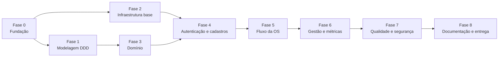

# Roadmap de Desenvolvimento - MVP SIAES

Este documento organiza o desenvolvimento do MVP do **Sistema Integrado de Atendimento e Execução de Serviços (SIAES)** em fases, da fundação do projeto até a entrega final do Tech Challenge da Fase 1. Cada tarefa referencia os requisitos de [requisitos-funcionais.md](docs/requisitos-funcionais.md) (RF) e [requisitos-nao-funcionais.md](docs/requisitos-nao-funcionais.md) (RNF), o [modelo C4](docs/ddd/c4-model.md) e os itens exigidos pelo enunciado. Para saber onde e como implementar cada tarefa, siga o [guia de desenvolvimento](docs/guia-de-desenvolvimento.md).

**Como usar:** marque a tarefa como concluída (`[x]`) no mesmo Pull Request que a entrega. A ordem das fases segue as dependências técnicas; fases sem dependência entre si podem andar em paralelo.

---

## Estado Atual

> Atualizado em 15/10/2026, considerando a `main` até o commit `c63c963` (health check da API) e o Event Storming exportado do Miro.

| Item | Situação |
| :--- | :--- |
| Requisitos funcionais e não funcionais | Na `main`: RF-01 a RF-23 e RNF-01 a RNF-13. A branch `docs/fechamento-fase-0` (Gabriel, ainda sem merge) os renumera para RF-01 a RF-27 e RNF-01 a RNF-16 e acrescenta regras novas (ver Fase 0) |
| Linguagem ubíqua | Revisada (máquina de estados, bounded contexts e perfis); nomes ainda divergem do modelo C4. A branch `docs/fechamento-fase-0` traz a versão com 9 status |
| Modelo C4 | Documentado nos 4 níveis; a estrutura de pastas da seção 6 difere da que foi implementada |
| Guia de desenvolvimento e estrutura de pastas | Criados no PR #1, com instruções para assistentes de IA (`AGENTS.md`, `CLAUDE.md`); escritos sobre a versão anterior dos requisitos, por isso citam numeração e decisões desatualizadas. A branch `docs/fechamento-fase-0` os atualiza |
| Event Storming | Quadro no Miro com 3 áreas (Criação da OS, Acompanhar OS, Gestão administrativa), legível nas imagens exportadas por área. O PDF versionado no repositório continua em baixa resolução e o link do quadro não consta no repositório. Lacunas levantadas na Fase 1 |
| Código (`src/`) e testes | Rota `GET /health` em `src/presentation/api/main.py`. Os demais arquivos das camadas e da autenticação JWT continuam vazios; nenhum teste |
| Docker | Primeira versão de `Dockerfile` e `docker-compose.yml` (só o serviço `api`); diverge do RNF-12 (ver Fase 2) |
| README | Apenas título |

---

## Visão Geral das Fases

| Fase | Objetivo | Depende de | Resultado esperado | Situação |
| :--- | :--- | :--- | :--- | :--- |
| **0** | Fundação | - | Decisões fechadas, documentos alinhados entre si e ao enunciado, repositório configurado | Em andamento |
| **1** | Modelagem DDD | 0 | Event Storming completo e legível, diagramas e linguagem ubíqua consistentes entre si | Em andamento |
| **2** | Infraestrutura base | 0 | `docker compose up --build` sobe API + PostgreSQL com Swagger em `/docs` | Em andamento (health check e Docker inicial) |
| **3** | Domínio | 1 | Entidades, objetos de valor, eventos e regras de negócio com testes unitários | Não iniciada |
| **4** | Autenticação e cadastros | 2, 3 | Login JWT, RBAC, gestão de usuários e cadastros administrativos | Não iniciada (arquivos criados, vazios) |
| **5** | Fluxo da OS | 4 | Abertura, orçamento, reserva de estoque, aprovação, status e consulta pública | Não iniciada |
| **6** | Gestão e métricas | 5 | Listagem, detalhamento e tempo médio de execução | Não iniciada |
| **7** | Qualidade e segurança | 6 | Cobertura ≥ 80% comprovada, relatório de vulnerabilidades e medição de desempenho | Não iniciada |
| **8** | Documentação e entrega | 7 | README, documentação DDD final, vídeo e PDF de entrega | Não iniciada |

---

## Fase 0 - Fundação

**Objetivo:** fechar as decisões que bloqueiam o restante do trabalho, alinhar os documentos entre si e ao enunciado e preparar o repositório.

### Branch `docs/fechamento-fase-0` (pendente de merge)

O Gabriel publicou em 13 e 14/10 a branch `docs/fechamento-fase-0`, que ainda não entrou na `main`. Ela fecha várias pendências desta fase, e este roadmap só deve ser reescrito por completo depois do merge. Conteúdo informado nos commits:

- Requisitos renumerados (RF-01 a RF-27 e RNF-01 a RNF-16), com listagem e detalhamento de OS, gestão de segredos, análise de vulnerabilidades e testes de integração restaurados, e a menção a descontos removida
- Novos status `AGUARDANDO_PECA` e `AGUARDANDO_EXECUCAO`, peça pendente com reserva parcial e prioridade para a OS mais antiga, baixa no início da execução, histórico de status, estimativa de entrega e número da OS
- Linguagem ubíqua com os 9 status e a tabela de transições; C4, guia e estrutura de pastas alinhados à nova numeração
- Event Storming reexportado (com peça pendente e cancelamento), `presentation/routers/` e `presentation/schemas/` criados, `.gitignore`, `.env.example` e `pyproject.toml` (uv, pytest, Ruff, Python 3.12)

- [ ] Fazer o merge da branch na `main` por Pull Request
- [ ] Resolver o conflito esperado com a `main`: a branch usa `pyproject.toml` e remove `src/presentation/api/main.py` e `requirements.txt`, mas a `main` ganhou o health check, o `Dockerfile` e o `docker-compose.yml`, que dependem deles. Decidir onde fica a aplicação FastAPI (`presentation/api/` ou `presentation/routers/`) e como as dependências são instaladas no Docker
- [ ] Depois do merge, conferir o que a branch resolveu e reescrever as seções "Decisões de Domínio", "Alinhamento dos Requisitos com o Enunciado" e "Atualização do Guia" deste roadmap

### Decisões Técnicas

A seção 8 do guia de desenvolvimento ainda lista framework, ORM e biblioteca de JWT como não definidos, mas o modelo C4 e os RNFs já os definem (ver "Atualização do Guia de Desenvolvimento" abaixo).

| Decisão | Definição | Onde está registrada |
| :--- | :--- | :--- |
| Linguagem | Python 3.12 | RNF-02, RNF-12 |
| Framework web | FastAPI + Uvicorn | Modelo C4 |
| Banco de dados | PostgreSQL 16 | RNF-07 |
| ORM | SQLAlchemy | RNF-04, Modelo C4 |
| JWT e hash de senha | PyJWT e Passlib/bcrypt | RF-03, Modelo C4 |
| Testes e cobertura | pytest + pytest-cov | RNF-10, RNF-11 |
| Eventos de domínio | Event Dispatcher síncrono em memória | Modelo C4 |
| Módulos críticos (meta de 80%) | Domínio e aplicação | RNF-11 |
| Documentação da API | Swagger UI em `/docs` | RNF-13 |
| Branches e commits | Branches `<tipo>/<descricao-curta>` e commits `<tipo>: <descrição>` em português | Guia de desenvolvimento, seção 7 |
| Imports | Absolutos a partir de `src/` | Guia de desenvolvimento, seção 4.2 |
| Configuração do `PYTHONPATH` para os imports | **Pendente** | Guia de desenvolvimento, seção 8 |
| Migrations | **Pendente** (sugestão: Alembic) | - |
| Rate limiting | **Pendente** (sugestão: SlowAPI) | RNF-05 |
| Análise de vulnerabilidades | **Pendente** (sugestão: pip-audit, Bandit e Trivy) | - |
| Teste de desempenho | **Pendente** (sugestão: Locust ou k6) | RNF-08 |
| Lint e formatação | **Pendente** (sugestão: Ruff) | - |
| Arquivo de dependências | **Pendente** (`pyproject.toml` ou `requirements.txt`) | Guia de desenvolvimento, seção 8 |

### Decisões de Domínio

- [x] Transições de status e responsáveis por cada uma ([linguagem-ubiqua.md](docs/ddd/linguagem-ubiqua.md) seção 5, RF-13 a RF-20)
- [x] Identificação do cliente na consulta pública: número da OS + CPF/CNPJ (RF-21)
- [x] Aprovação e rejeição do orçamento pelo cliente em rota pública (RF-22)
- [x] Perfis de acesso com RBAC: Atendente, Mecânico e Gerente (RF-02)
- [x] Carga inicial do usuário Gerente `admin@oficina.com` (RF-03)
- [x] Remoção lógica de clientes e veículos (RF-06, RF-09)
- [ ] Exclusão de serviços e peças: lógica ou física? Os itens da OS guardam `servico_id` e `peca_id` (RF-11, RF-12)
- [ ] O que acontece quando não há saldo suficiente para reservar as peças ao concluir o orçamento (RF-16)
- [ ] De onde vem a "estimativa de entrega" retornada na consulta pública; não há campo para isso no modelo de classes (RF-21)
- [ ] Estrutura do histórico de auditoria da OS citado no RF-20 (ex.: status anterior, novo status, usuário, data/hora e motivo)
- [ ] Usuários de demonstração de Atendente e Mecânico, já que a carga inicial cria apenas o Gerente
- [ ] Senha do usuário da carga inicial lida de variável de ambiente, sem valor fixo no repositório
- [ ] Registrar na documentação que `CANCELADA` é um status acrescentado à lista do enunciado e o motivo

### Alinhamento dos Requisitos com o Enunciado

A revisão dos RNFs removeu itens que o enunciado continua exigindo. Eles precisam voltar aos requisitos ou, no mínimo, ao roadmap e ao README:

- [ ] **Análise de vulnerabilidades:** o enunciado exige o relatório no repositório e sua apresentação no vídeo; o requisito que tratava disso foi removido
- [ ] **Testes de integração dos fluxos principais:** o RNF-10 cobre apenas testes unitários de domínio, mas o enunciado exige os dois tipos
- [ ] **Ausência de credenciais no repositório:** o requisito sobre segredos e `.env` foi removido, mas o enunciado proíbe credenciais, senhas e tokens no repositório
- [ ] **Listagem e detalhamento de Ordens de Serviço:** exigidos pelo enunciado, mas sem RF próprio desde a revisão
- [ ] **Descontos e taxas:** o RNF-10 prevê testes de "lógica de desconto/taxas", mas nenhum RF define essa regra; incluir um RF ou remover a menção
- [ ] **Identificação na consulta pública:** RF-21 exige número da OS + CPF/CNPJ, enquanto o RNF-04 admite UUID público e a tabela de atores do modelo C4 cita também a placa; padronizar

### Atualização do Guia de Desenvolvimento e da Estrutura de Pastas

A branch do PR #1 foi criada antes da revisão dos requisitos (commit `3540bed`). Por isso, [guia-de-desenvolvimento.md](docs/guia-de-desenvolvimento.md) e [estrutura-de-pastas.md](docs/estrutura-de-pastas.md) citam a versão anterior (RF-01 a RF-17, RNF-01 a RNF-11). Como o guia é a porta de entrada para o grupo e para os assistentes de IA, a atualização é prioritária.

- [ ] Atualizar a numeração dos requisitos citados. Exemplos: o guia remete os valores de `StatusOS` ao RF-13, que hoje é a abertura da OS, e o cálculo do orçamento ao RF-10, que hoje é a listagem do catálogo de serviços
- [ ] Seção 5.6 do guia: incluir a aprovação e a rejeição do orçamento (RF-22) entre as rotas públicas (o guia diz que a única rota pública é a consulta de status) e restringir a identificação a número da OS + CPF/CNPJ (RF-21)
- [ ] Guia (seção 5.6) e estrutura de pastas (seção 5): usar o perfil `Gerente` em vez de `Administrador` e prever a resposta `403` para perfil sem permissão (RF-02), ausente da lista de códigos HTTP da seção 5.5
- [ ] Seção 5.4 do guia: trocar a regra antiga de estoque (baixa e bloqueio na aprovação) pela atual: reserva em `AGUARDANDO_APROVACAO`, baixa na aprovação e estorno na rejeição ou no cancelamento (RF-16, RF-17, RF-22)
- [ ] Seção 5.2 do guia: refletir os timestamps de início e fim da execução e o histórico de auditoria (RF-17, RF-18, RF-20) no lugar do antigo registro de horário em cada transição
- [ ] Seção 8 do guia: marcar framework, ORM e biblioteca de JWT como definidos e remover a pendência do critério de aceite da abertura da OS, já preenchido no RF-13
- [ ] Revisar as citações a RNF-04 (segredos), RNF-05 (vulnerabilidades), RNF-09 (testes de integração) e RNF-11 (DTOs e códigos HTTP): esses requisitos foram removidos ou renumerados. Restaurá-los resolve também parte do alinhamento com o enunciado acima

### Repositório

- [ ] Proteger a branch `main` no GitHub. O PR #1 seguiu o fluxo, mas os commits `3540bed` e `2f87c23` entraram direto na `main`; confirmar a proteção nas configurações do repositório
- [x] Definir o padrão de branches e de mensagens de commit (guia de desenvolvimento, seção 7)
- [ ] Criar `.gitignore` para Python (incluindo `.env`, `.venv/`, `__pycache__/` e relatórios de cobertura); a branch `docs/fechamento-fase-0` já traz um
- [ ] Remover da `main` os dois arquivos `.pyc` commitados no health check (`src/presentation/__pycache__/` e `src/presentation/api/__pycache__/`), junto com a criação do `.gitignore`
- [ ] Criar `.env.example` com as variáveis necessárias, sem valores reais (já existe na branch `docs/fechamento-fase-0`)
- [ ] Unificar o arquivo de dependências: a `main` tem `requirements.txt` (só `fastapi` e `uvicorn`) e a branch `docs/fechamento-fase-0` tem `pyproject.toml`; manter apenas um

### Estrutura de Pastas

- [x] Reorganizar os arquivos de código em camadas (`domain`, `application`, `infrastructure`, `presentation`) (PR #1)
- [x] Separar `tests/unit/` e `tests/integration/` e criar `docs/security/` (PR #1)
- [ ] Unificar a estrutura de pastas: a seção 6 do modelo C4 e a seção 2 do guia descrevem estruturas diferentes. Como o guia proíbe criar pastas sem acordo do grupo, a decisão precisa sair antes da implementação de eventos, rate limiting e acesso ao banco
- [ ] Atualizar as seções 1 e 4 do modelo C4, que ainda chamam a camada de entrada de `src/api/`

| Pasta | Modelo C4 (seção 6) | Código e guia |
| :--- | :--- | :--- |
| `presentation/controllers/` | Prevista (rotas por recurso) | Não existe |
| `presentation/middlewares/` | Prevista (JWT e rate limiting) | Autenticação em `presentation/auth/` |
| `presentation/schemas/` | Pasta | Arquivo único `presentation/schemas.py` |
| `application/events/` e `application/handlers/` | Previstas (Event Dispatcher e `BaixaEstoqueHandler`) | Não existem |
| `domain/events/` | Prevista (`OrcamentoAprovadoEvent`) | Não existe |
| `infrastructure/database/` | Prevista (engine e sessões do SQLAlchemy) | Não existe |

---

## Fase 1 - Modelagem DDD

**Objetivo:** concluir uma modelagem legível e consistente entre todos os documentos. Os nomes definidos aqui são os que aparecerão nas classes, e o enunciado não aceita documentação que não corresponda à implementação.

### Event Storming

- [x] Event Storming do fluxo de criação da OS (área "Criação da ordem de serviço")
- [x] Event Storming do acompanhamento da OS (área "Acompanhar OS")
- [x] Event Storming da gestão administrativa (área "Gestão administrativa"): CRUD de serviços, peças, clientes, veículos e OSs com validação de perfil
- [ ] Reexportar [event-storming.pdf](docs/ddd/event-storming.pdf) em alta resolução ou em formato vetorial, exportando uma área por vez; o arquivo da `main` é uma única imagem de 1753 × 570 pixels em que o texto dos post-its não é legível (a branch `docs/fechamento-fase-0` traz uma nova exportação, a conferir depois do merge)
- [ ] Garantir acesso público ao board (Miro ou equivalente), sem necessidade de pedir permissão, e registrar o link no repositório
- [ ] Transcrever em texto os eventos de domínio, comandos, políticas e atores levantados, para referência no código e na linguagem ubíqua (por exemplo em `docs/ddd/event-storming.md`)

**Lacunas do quadro atual do Event Storming** (levantadas em 15/10/2026 com base nas imagens exportadas do Miro):

- [ ] Modelar as etapas finais da OS, hoje reduzidas ao comando genérico "Atualizar status da OS": execução iniciada, manutenção concluída (mecânico) e veículo entregue (atendente), com os timestamps usados no tempo médio de execução
- [ ] Modelar a reserva, a baixa e o estorno do estoque: `OS reprovada` e `Cancelar OS` não disparam nenhuma política de devolução das peças, e o quadro só mostra "Atualiza estoque" ao adicionar peças
- [ ] Criar o Event Storming próprio da gestão de peças e insumos, exigido pelo enunciado: hoje há só o CRUD de peças e a chegada de peça dentro do fluxo da OS. Incluir entrada e saída de estoque, reserva, baixa e peça pendente
- [ ] Incluir os fluxos que os requisitos citam e o quadro não mostra: gestão de usuários internos pelo Gerente e relatório de tempo médio de execução
- [ ] Incluir os caminhos de erro: credenciais inválidas na consulta pública, estoque insuficiente e transição de status inválida
- [ ] Representar os demais elementos de DDD exigidos pelo enunciado: o agregado `EstoquePeca` (hoje só aparece `Ordem de Serviço`), entidades, objetos de valor e bounded contexts
- [ ] Revisar detalhes: "Entre com credenciais" deve ser "Entra com credenciais"; "Atualizar peça" parece sem política de validação de perfil, enquanto os requisitos permitem que Atendente e Mecânico atualizem o saldo; nomear a credencial do cliente como CPF/CNPJ, como nos requisitos; explicitar a seta que sai da área de criação da OS (provavelmente liga ao "Criar OS" da administração); conferir a legenda "PA" (losango vermelho)

### Consistência entre Documentos

- [ ] Padronizar os objetos de valor de documento: a linguagem ubíqua define `CPF` e `CNPJ` separados (exemplo `cpf.py`), o modelo C4 usa um único `CpfCnpj` e o guia e a estrutura de pastas citam `cpf_cnpj.py`
- [ ] Incluir na linguagem ubíqua os termos presentes no modelo C4: `Usuario`, `PerfilUsuario`, `ItemServico`, `ItemPeca`, reserva de estoque e eventos de domínio
- [ ] Usar o objeto de valor `Valor` (precisão decimal) nos preços do diagrama de classes, que hoje aparecem como `float`
- [ ] Completar o diagrama de classes com `Servico`, `Peca`/`EstoquePeca`, `Orcamento` e o histórico de auditoria, e esclarecer se `Peca` e `EstoquePeca` são a mesma entidade
- [ ] Listar todos os eventos de domínio; o modelo C4 cita apenas `OrcamentoAprovadoEvent` e `StatusOSAlteradoEvent`, mas o RF-16 também depende de eventos de rejeição e cancelamento para o estorno

### Diagramas

- [x] Modelo C4 nos níveis de contexto, contêineres, componentes e código
- [x] Bounded contexts e máquina de estados descritos na linguagem ubíqua
- [ ] Conferir no material da disciplina de DDD quais diagramas são obrigatórios e produzir os que faltarem
- [ ] Exportar os diagramas para `docs/ddd/diagramas.pdf`, estrutura sugerida pelo enunciado

---

## Fase 2 - Infraestrutura Base

**Objetivo:** ter o ambiente completo subindo com um único comando antes de iniciar as funcionalidades.

**Já feito (commit `c63c963`, Guilherme):** rota `GET /health` em `src/presentation/api/main.py`, `Dockerfile` e `docker-compose.yml` com o serviço `api` e healthcheck. Ajustes necessários nessa primeira versão:

- [ ] `Dockerfile`: trocar Python 3.11 por 3.12, usar build multi-stage e executar com usuário não-root (RNF-12, RNF-02)
- [ ] `Dockerfile`: o comando `uvicorn src.presentation.api.main:app` exige o prefixo `src.`, o que quebra os imports absolutos a partir de `src/` definidos no guia; ajustar junto com o `PYTHONPATH`
- [ ] `docker-compose.yml`: remover o volume `.:/app`, que sobrescreve o código copiado para a imagem (manter apenas em um arquivo de override para desenvolvimento, se necessário) e o campo `version`, obsoleto no Compose v2
- [ ] `src/presentation/api/`: criar o `__init__.py` e decidir se a aplicação fica nessa pasta ou em `presentation/routers/`; o guia exige `__init__.py` em toda pasta e não prevê `api/`

Tarefas da fase:

- [ ] `docker-compose.yml` com os serviços `app` e `db` (PostgreSQL 16), volume persistente para o banco e healthcheck, subindo com `docker compose up --build` (RNF-12); hoje existe só o serviço `api`
- [ ] Configuração do `PYTHONPATH` (ou empacotamento) para os imports a partir de `src/` funcionarem localmente, no Docker e no pytest
- [ ] Configuração por variáveis de ambiente, sem segredos no código
- [ ] Engine e sessão do SQLAlchemy com controle de transação e rollback completo em caso de falha (RNF-06)
- [ ] Migrations iniciais
- [x] Rota de health check na aplicação FastAPI (`GET /health`)
- [ ] Conferir o Swagger em `/docs`, exposto automaticamente pelo FastAPI, e documentar o acesso (RNF-13)
- [ ] Tratamento padronizado de erros, traduzindo as exceções do domínio para códigos HTTP, incluindo `401` e `403` (RNF-03)
- [ ] Event Dispatcher síncrono em memória (Modelo C4)
- [ ] Estrutura para testes de integração com banco PostgreSQL de teste
- [ ] (Recomendado) Pipeline de CI no GitHub Actions executando lint, testes e cobertura em cada Pull Request

---

## Fase 3 - Domínio

**Objetivo:** implementar o núcleo de regras de negócio com `dataclasses` puras, sem dependência de framework ou ORM (RNF-02). É a camada que concentra a meta de cobertura. As receitas de objeto de valor, entidade e porta de repositório estão nas seções 5.1 a 5.3 do guia.

**Dependência da Fase 1:** as etapas finais da OS, o estorno de estoque e o agregado `EstoquePeca` precisam estar modelados antes da implementação (ver lacunas do Event Storming).

**Ponto de partida:** `entities/ordem_servico.py`, `entities/usuario.py`, `repositories/ordem_servico_repository.py` e `repositories/usuario_repository.py` já existem em `src/domain/`, vazios.

### Objetos de Valor

- [ ] CPF e CNPJ com validação dos dígitos verificadores (RF-05)
- [ ] `Placa` nos padrões antigo (`ABC1234`) e Mercosul (`ABC1D23`) (RF-08)
- [ ] `Valor` com precisão decimal
- [ ] `StatusOS` e `PerfilUsuario`

### Entidades e Agregados

- [ ] Exceções de regra de negócio em `src/domain/exceptions.py`
- [ ] `Cliente`, `Veiculo`, `Usuario` e `Servico`
- [ ] Agregado `OrdemServico` com `ItemServico` e `ItemPeca`, congelando os preços vigentes no cálculo do orçamento (RF-15, RNF-09)
- [ ] Cálculo do orçamento como soma dos valores congelados (RF-15)
- [ ] Máquina de estados com bloqueio de transições inválidas: `atribuir_mecanico`, `finalizar_orcamento`, `aprovar_orcamento`, `rejeitar_orcamento`, `concluir_manutencao`, `entregar_veiculo` e `forcar_cancelamento` (RF-13 a RF-20)
- [ ] Registro dos timestamps de abertura, início da execução e finalização (RF-13, RF-17, RF-18)
- [ ] Bloqueio de alteração de itens após `FINALIZADA` (RF-18)
- [ ] Histórico de auditoria com motivo do cancelamento forçado (RF-20)
- [ ] Agregado `EstoquePeca` com saldo físico, reserva temporária, baixa e estorno, sem permitir saldo negativo (RF-12, RF-16, RF-17)
- [ ] Eventos de domínio acumulados no agregado (`collect_domain_events`)
- [ ] Interfaces (portas) dos repositórios

### Testes

- [ ] Testes unitários dos objetos de valor, da máquina de estados, do cálculo do orçamento e das regras de estoque, usando repositórios em memória (RNF-10)

---

## Fase 4 - Autenticação e Cadastros Administrativos

**Objetivo:** disponibilizar o acesso autenticado com controle por perfil e os cadastros que alimentam a Ordem de Serviço.

**Ponto de partida:** os arquivos da autenticação já existem, vazios, distribuídos pelas camadas conforme a seção 5 de [estrutura-de-pastas.md](docs/estrutura-de-pastas.md) (portas `TokenService` e `PasswordHasher`, caso de uso `autenticar_usuario.py`, adaptadores de JWT e bcrypt e `presentation/auth/dependencies.py`).

- [ ] Login com e-mail e senha, emitindo JWT com a claim `role` e expiração de 24 horas (RF-01)
- [ ] Guard de RBAC retornando `401` sem token válido e `403` sem permissão (RF-02, RNF-03)
- [ ] Gestão de usuários internos exclusiva do Gerente, com senhas em hash bcrypt (RF-03)
- [ ] Carga inicial do Gerente na subida do container (RF-03)
- [ ] Cadastro, atualização e listagem de clientes, com validação de CPF/CNPJ (RF-04, RF-05)
- [ ] Exclusão lógica de clientes pelo Gerente (RF-06)
- [ ] Cadastro, atualização e listagem de veículos vinculados ao cliente, com validação de placa (RF-07, RF-08)
- [ ] Exclusão lógica de veículos por Atendente e Gerente (RF-09)
- [ ] Listagem do catálogo de serviços (RF-10) e CRUD restrito ao Gerente (RF-11)
- [ ] Gestão de peças e atualização de saldo de estoque com permissões por perfil (RF-12)
- [ ] Testes de integração das rotas, cobrindo acesso sem token (`401`) e com perfil sem permissão (`403`)

---

## Fase 5 - Fluxo da Ordem de Serviço

**Objetivo:** implementar o fluxo central do sistema, da abertura à entrega do veículo.

### Frente da Loja

- [ ] Abertura da OS com status `RECEBIDA`, carregando cliente e veículo existentes ou cadastrando-os no mesmo fluxo (RF-13, RF-04, RF-07)
- [ ] Atribuição do mecânico com transição para `EM_DIAGNOSTICO` (RF-14)
- [ ] Inclusão de serviços e peças e cálculo do orçamento, com transição para `AGUARDANDO_APROVACAO` (RF-15)
- [ ] Reserva temporária das peças ao entrar em `AGUARDANDO_APROVACAO` (RF-16)
- [ ] Conclusão da manutenção com transição para `FINALIZADA` (RF-18)
- [ ] Entrega do veículo com transição para `ENTREGUE`, restrita a Atendente e Gerente (RF-19)
- [ ] Cancelamento forçado e alteração excepcional de status pelo Gerente, com motivo no histórico e estorno das peças (RF-20, RF-16)

### Frente do Cliente

- [ ] Consulta pública por número da OS + CPF/CNPJ, sem expor dados pessoais sensíveis (RF-21, RNF-04)
- [ ] Rate limiting nas rotas públicas (ex.: 10 requisições por minuto por IP) (RNF-05)
- [ ] Aprovação do orçamento com transição para `EM_EXECUCAO` e baixa das peças via `OrcamentoAprovadoEvent` e `BaixaEstoqueHandler` (RF-22, RF-17)
- [ ] Rejeição do orçamento com transição para `CANCELADA` e estorno automático das peças (RF-22, RF-16)
- [ ] Garantir que a transição de status e a movimentação de estoque ocorram na mesma transação, inclusive quando disparadas por eventos (RNF-06)

### Testes

- [ ] Teste de integração do fluxo completo: abertura → diagnóstico → orçamento → aprovação → execução → finalização → entrega
- [ ] Testes de integração dos fluxos de rejeição e de cancelamento forçado, verificando o estorno das peças
- [ ] (Recomendado) Teste de concorrência com duas aprovações disputando a mesma peça (RNF-07)

---

## Fase 6 - Gestão e Métricas

**Objetivo:** fornecer as visões administrativas sobre as Ordens de Serviço.

- [ ] Listagem de OS com filtros (exigida pelo enunciado; ver alinhamento na Fase 0)
- [ ] Detalhamento da OS com histórico, cliente, veículo, itens e valores (exigido pelo enunciado; ver alinhamento na Fase 0)
- [ ] Relatório do tempo médio de execução, de `EM_EXECUCAO` até `FINALIZADA`, agrupado por período e por mecânico e restrito ao Gerente (RF-23)
- [ ] Testes de integração das rotas

---

## Fase 7 - Qualidade e Segurança

**Objetivo:** consolidar as evidências de qualidade e segurança exigidas na entrega.

- [ ] Cobertura ≥ 80% nos módulos de domínio e aplicação, medida com `pytest-cov` (RNF-11)
- [ ] Evidência da cobertura salva (relatório ou captura de tela) para uso no README e no vídeo
- [ ] Varredura de vulnerabilidades de dependências, código e imagem Docker, com correção do que for encontrado
- [ ] Relatório da análise de vulnerabilidades salvo em `docs/security/`
- [ ] Revisão das proteções contra SQL Injection, IDOR e XSS (RNF-04) e do rate limiting (RNF-05)
- [ ] Medição do tempo de resposta (p95 < 500 ms) com evidência registrada (RNF-08)
- [ ] Revisão do repositório: nenhum segredo, senha ou token no código ou no histórico do git
- [ ] Revisão do Swagger: schemas de entrada e saída, códigos HTTP e autenticação Bearer (RNF-13)

---

## Fase 8 - Documentação e Entrega

**Objetivo:** reunir tudo o que será avaliado. A correção considera apenas o commit informado no PDF de entrega.

### README.md

- [ ] Objetivo do projeto
- [ ] Descrição resumida da solução
- [ ] Arquitetura utilizada (pode referenciar o [modelo C4](docs/ddd/c4-model.md))
- [ ] Tecnologias utilizadas
- [ ] Pré-requisitos
- [ ] Instruções para execução
- [ ] Instruções para execução dos testes
- [ ] Instruções de acesso ao Swagger (`/docs`)
- [ ] Decisão e justificativa do banco de dados (pode reaproveitar o RNF-07)
- [ ] Usuários de demonstração e procedimento de autenticação
- [ ] Estrutura dos principais diretórios (pode reaproveitar o guia de desenvolvimento)
- [ ] Link para a documentação DDD
- [ ] Link para o vídeo da entrega

### Documentação DDD

- [ ] Conferir se o board, os PDFs exportados e os diagramas correspondem ao código final
- [ ] Atualizar o mapeamento entre documentação e código na linguagem ubíqua

### Vídeo

Publicado no YouTube como **público**, com no máximo **15 minutos**, áudio compreensível e identificação dos integrantes.

- [ ] Roteiro cobrindo os pontos exigidos: proposta da solução, arquitetura, organização do monólito e camadas, escolha do banco de dados, Event Storming, elementos de DDD, criação e acompanhamento da OS, inclusão de serviços/peças/insumos, geração e aprovação do orçamento, alteração de status, autenticação das APIs administrativas, execução da aplicação, Swagger, testes automatizados e análise de vulnerabilidades
- [ ] Gravação com a aplicação rodando na versão do commit final
- [ ] Publicação e teste do link

### PDF de Entrega

- [ ] Primeira página: curso (SOAT - Software Architecture), fase 1, número do grupo, nome completo e RM de todos os integrantes, usernames do Discord, linguagem e principais tecnologias
- [ ] Links clicáveis do repositório, do vídeo e do board do Event Storming
- [ ] Branch e hash do commit final (recomendado: criar também uma tag, ex.: `v1.0-fase1`)
- [ ] Testar todos os links em uma janela anônima antes do envio

---

## Definição de Pronto

Uma tarefa de código só é considerada concluída quando:

- foi integrada à `main` via Pull Request revisado por outro integrante, citando os requisitos atendidos (guia de desenvolvimento, seção 7);
- respeita a regra de dependência entre camadas (guia de desenvolvimento, seção 2.1);
- possui testes unitários e/ou de integração passando, incluindo as permissões por perfil quando houver rota protegida;
- o endpoint está refletido corretamente no Swagger;
- a linguagem ubíqua foi atualizada, caso algum termo do domínio tenha surgido ou mudado;
- não introduz segredos no repositório.
